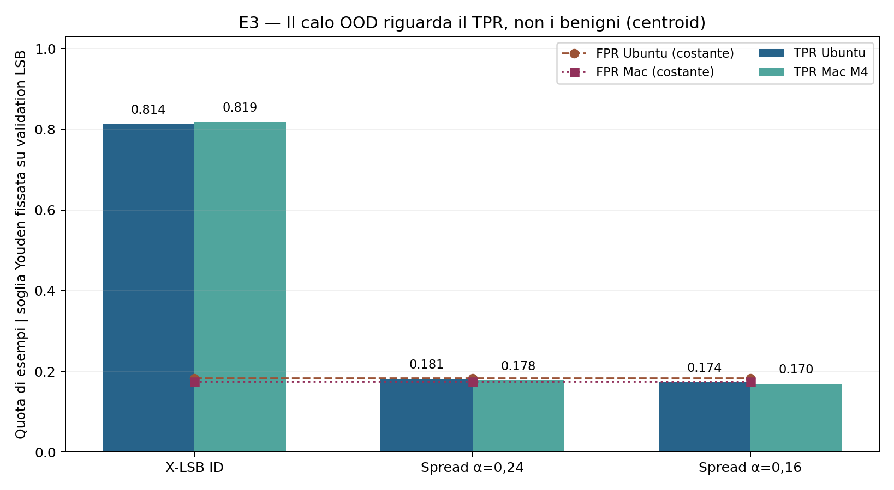

# E3 — Controlli matched e metadati | Beyond the X-Ray

**Resoconto autonomo del terzo esperimento.** I numeri provengono dal confronto Ubuntu/Mac E3 comunicato nei log del 22 ottobre 2026; non da nuove esecuzioni. Per contesto e citazioni vedere `exam/PROJECT_REPORT.md` e `docs/E3_PROTOCOL_CONTROLS.md`.

## PARTE III — E3: controlli retrospettivi con benigni appaiati e metadati

### 23. Perché E3 è necessario dopo E1 ed E2

La sequenza scientifica del progetto è deliberata. **E1** misura il comportamento *in-distribution* di un detector Siamese addestrato e valutato con X-LSB, utilizzando checkpoint sorgente disgiunti. **E2** conserva l'addestramento X-LSB X=23 ma valuta lo stesso detector per fit su X-LSB (*ID*) e su due intensità di uno spread-spectrum additivo a 16 bit mai incontrato nel training (*OOD*). Su entrambe le piattaforme l'AUROC centroid passa da circa 0,904 a 0,475–0,478 per α=0,24. Il solo valore AUROC non chiarisce, però, **quali controlli rimangano invariati** e **quale classe generi gli errori**.

Il piano d'esame (roadmap del 15 ottobre 2026, work package A4) indica E3 come controllo con **benigni appaiati e metadati bilanciati**. Pertanto E3 non introduce un nuovo payload, una nuova variante del Siamese o un'altra campagna di training. Rilegge, con codice indipendente dal calcolo originale delle metriche aggregate, gli **score per checkpoint già generati e auditati in E2**. I risultati E3 sono quindi **retrospettivi**, non un secondo holdout blind e non una nuova dimostrazione causale.

Le domande verificabili sono quattro: (C1) benigno e modificato derivano sempre dalla stessa identità di checkpoint e sono presenti 1:1? (C2) `row_index`, `model_id` e hash della sorgente possono predire l'etichetta semplicemente identificando il checkpoint? (C3) a modello e soglia invariati, il calo OOD deriva da un cambiamento dei benigni e del FPR oppure dalla mancata rilevazione dei modificati? (C4) i controlli si ripetono con la stessa logica su Ubuntu x86 virtualizzato e su Mac M4 ARM64?

### 24. Input, unità di analisi e invarianti verificati

#### 24.1 Materiale sperimentale e indipendenza dei dati

Il controllo legge gli artifact **ufficiali E2** dalle directory locali `e2_test_official_ubuntu_v1` ed `e2_test_official_mac_m4_v1`, in particolare le tabelle di predizione a livello di checkpoint, i manifest e le soglie registrate. Non vengono generati nuovi esempi né aggiornati pesi, embedding, seed o thresholds. Il programma è `scripts/e3_matched_controls.py`, con test unitario `tests/test_e3_controls.py`; il confronto tra piattaforme è `scripts/e3_compare_controls.py`. La versione del codice E3 è stata archiviata nel commit `e82a4d8` del branch `ricky`.

Ogni fit comprende **200 checkpoint sorgente nel test E2**, tre condizioni (`LSB_ID`, `SPREAD_0.16`, `SPREAD_0.24`) e due metodi di scoring (`centroid`, `nn`). Per ciascuna combinazione **repeat × metodo × condizione × `row_index`** deve esistere una coppia di osservazioni, una con etichetta 0 (benigno) e una con etichetta 1 (modificato), con gli stessi identificatori e hash di origine. L'audit controlla anche lo split checkpoint-disjoint 600/200/200 congelato in E1.

Il conto dei confronti è **10 repeat × 3 condizioni × 2 metodi × 200 sorgenti = 12.000 coppie per piattaforma**; corrispondono a 24.000 osservazioni *entro piattaforma* (un benigno e un modificato per coppia). **Non sono 12.000 checkpoint originali indipendenti:** lo stesso insieme di 200 sorgenti test viene riutilizzato nei dieci fit e nelle differenti condizioni/metodi. Il numero di record aggregati per piattaforma è 10 × 3 × 2 = **60**.

#### 24.2 Controlli a esito vincolante (*fail-closed*)

Il controllo rifiuta coppie mancanti o duplicate, identificatori di checkpoint diversi entro una coppia, incongruenze con lo split, label sbilanciate, punteggi non finiti e incoerenze fra gli score e le metriche registrate. La lettura dei CSV usa `float_precision='round_trip'` per conservare la semantica delle soglie float64 molto vicine a uno score: è il caso che aveva causato il falso allarme dell'audit Mac durante E2. La verifica strutturale dei benigni controlla che, *all'interno dello stesso fit e metodo*, il medesimo checkpoint benigno ottenga lo stesso score nelle tre condizioni ID/OOD. Non significa che Ubuntu e Mac producano punteggi identici bit a bit.

Il campo denominato `X=23`, ereditato nello schema del runner E2, è un **campo di protocollo** presente anche nei record OOD: non implica che sui campioni spread sia stato applicato X-LSB. La famiglia effettiva è registrata da `condition` e dal manifest dei payload, ed è determinata dal ramo dell'algoritmo utilizzato nel runner.

### 25. Metriche di controllo e significato dei negative controls

#### 25.1 Bilanciamento e baseline costruita sui metadati

A parità di identità di checkpoint (stessi `row_index`, `model_id`, SHA), si trovano **esattamente un campione benigno e uno modificato** per ogni condizione e metodo. Pertanto un predittore che assegni a ogni checkpoint la sola classe maggioritaria e utilizzi esclusivamente tali **identificatori appaiati** raggiunge per costruzione un'accuracy del **50%**. È una verifica di bilanciamento, **non** un nuovo classificatore sui metadati addestrato e validato; non esclude che altri metadati di trasformazione, serializzazione o caratteristiche delle rappresentazioni possano lasciare tracce.

#### 25.2 TPR, FNR e FPR con soglia fissa

Per ogni repeat e metodo, E2 aveva determinato la soglia con il criterio di Youden **esclusivamente sulla validation X-LSB**. E3 applica la stessa soglia congelata alle tre condizioni test. Con TP, FN, FP e TN calcolati sulle etichette reali:

- **TPR = TP / (TP + FN):** quota di checkpoint modificati riconosciuti come modificati.
- **FNR = FN / (TP + FN) = 1 − TPR:** quota di modificati che il detector lascia passare come benigni.
- **FPR = FP / (FP + TN):** quota dei benigni classificati falsamente come modificati.

Se gli score dei benigni restano identici e la soglia non cambia, il loro FPR deve rimanere **costante tra `LSB_ID` e `SPREAD_*`**, a parità di piattaforma, repeat e metodo. Pertanto un forte calo nel TPR a FPR invariato evidenzia che la mancata detection si concentra sui campioni modificati, senza autorizzare una spiegazione causale completa del meccanismo.

#### 25.3 Concordanza appaiata distinta dall'AUROC

Per ciascuna delle 200 identità sorgente, si confrontano lo score modificato e lo score benigno **dello stesso checkpoint**. La *matched concordance* è la proporzione di casi `score(modificato) > score(benigno)`, con mezzo punto per i pareggi. Un valore intorno a **0,5** indica che questo ordinamento interno alla coppia non è sistematicamente favorevole al modificato. **Non coincide con l'AUROC**, che confronta anche coppie positive/negative appartenenti a identità sorgente differenti e dipende dal ranking sull'intero insieme.

### 26. Esecuzione, audit e replica indipendente Ubuntu/Mac

Il test unitario su Ubuntu ha restituito `E3 CONTROLS UNIT TEST OK: 1:1 pairing, perfect metadata balance, corrupt-pair fail-closed`; il runner reale `e3_matched_controls.py` ha completato le ripetizioni **00–09** con 200 identità per ciascuno dei sei gruppi condizione/metodo, con messaggio `E3 MATCHED/METADATA CONTROLS QA OK`. Fabrizio ha eseguito il medesimo self-test e il medesimo audit sulle predizioni originali del suo Mac M4, ottenendo lo stesso messaggio di superamento. Non sono stati riavviati training del Siamese né consultate nuove riserve test.

I risultati su Mac sono stati trasferiti mediante `E3_MAC_M4_RESULTS.zip`, contenente `e3_controls_per_fit.csv`, `e3_controls_summary.csv`, `e3_source_manifest.json` ed `E3_CONTROLS_REPORT.md`. Il confronto è stato eseguito da Riccardo su Ubuntu con `scripts/e3_compare_controls.py`, che verifica **60 righe per piattaforma appaiate per repeat, metodo e condizione**, coerenza degli SHA dello script E3, del runner E2 e dello split, bilanciamento, identità dei benigni e finitezza delle metriche. L'output osservato è: **`E3 CROSS-PLATFORM QA OK: 60 paired fit/method/condition records per platform`**. Il rapporto sorgente è `~/mlsec-local/runs/e3_cross_platform_v1/E3_CROSS_PLATFORM_REPORT.md`.

È una replica computazionale su due hardware, **non** una replicazione su nuove architetture CNN, un nuovo zoo o un set di checkpoint indipendente. E3 non genera un nuovo numero di osservazioni scientificamente indipendenti rispetto a E2.

### 27. Risultati E3: classificazione per condizione e per piattaforma

#### 27.1 Risultati centroid: confronto principale

| Indicatore centroid (media 10 fit) | Ubuntu ID X-LSB | Ubuntu OOD α=0,24 | Ubuntu OOD α=0,16 | Mac ID X-LSB | Mac OOD α=0,24 | Mac OOD α=0,16 |
|---|---:|---:|---:|---:|---:|---:|
| AUROC | 0,9043 | 0,4776 | 0,4947 | 0,9043 | 0,4745 | 0,4910 |
| TPR, soglia Youden da validation LSB | **0,8135** | **0,1815** | 0,1740 | **0,8190** | **0,1785** | 0,1695 |
| FNR (= 1−TPR) | 0,1865 | **0,8185** | 0,8260 | 0,1810 | **0,8215** | 0,8305 |
| FPR, stessa soglia | **0,1820** | **0,1820** | **0,1820** | **0,1750** | **0,1750** | **0,1750** |
| Concordanza entro coppia | 0,9265 | 0,4765 | 0,5030 | 0,9280 | 0,4800 | 0,4970 |

**Lettura del risultato:** su Ubuntu il TPR centroid diminuisce di **0,6320** (63,20 punti percentuali) da X-LSB a spread α=0,24, mentre l'FPR resta **0,1820**. Sul Mac il TPR diminuisce di **0,6405** (64,05 punti), con FPR costante **0,1750**. L'FNR sullo spread principale è quindi **81,85% Ubuntu e 82,15% Mac**. Queste percentuali descrivono l'errore del detector con la soglia **già fissata**, non una soglia ottimizzata sullo spread.

La concordanza appaiata centroid passa da oltre **0,92 ID** a circa **0,48 OOD**, aggiungendo un controllo basato sul confronto all'interno dello stesso checkpoint: anche evitando di confrontare benigni e modificati di checkpoint differenti, l'ordinamento degli score si perde sull'attacco OOD.

#### 27.2 Risultati secondari 1-NN

| Indicatore 1-NN (media 10 fit) | Ubuntu ID | Ubuntu OOD α=0,24 | Ubuntu OOD α=0,16 | Mac ID | Mac OOD α=0,24 | Mac OOD α=0,16 |
|---|---:|---:|---:|---:|---:|---:|
| AUROC | 0,8202 | 0,4805 | 0,4920 | 0,8167 | 0,4809 | 0,4891 |
| TPR | 0,7275 | 0,2330 | 0,2325 | 0,7190 | 0,2430 | 0,2315 |
| FNR | 0,2725 | 0,7670 | 0,7675 | 0,2810 | 0,7570 | 0,7685 |
| FPR | 0,2385 | 0,2385 | 0,2385 | 0,2390 | 0,2390 | 0,2390 |
| Concordanza entro coppia | 0,8470 | 0,4810 | 0,4895 | 0,8500 | 0,4830 | 0,4935 |

Anche il metodo secondario 1-NN mostra la stessa *direzione* del fenomeno: FPR identico fra condizioni all'interno della piattaforma, forte aumento dei falsi negativi OOD e concordanza entro coppia prossima a 0,5. Il risultato primario del protocollo resta **AUROC centroid / ΔAUROC di E2**, e i controlli E3 non cambiano a posteriori questo criterio.

*Figura E3-1. Valori medi ricostruiti dai riepiloghi E3 Ubuntu/Mac comunicati nel confronto approvato. Le barre non rappresentano checkpoint indipendenti aggiuntivi.*

### 28. Interpretazione: cosa si esclude e cosa resta aperto

**Conclusioni supportate:** (i) l'appaiamento delle identità di checkpoint è verificato, e gli stessi identificatori non permettono una regola di classe maggioritaria migliore del 50% nel disegno 1:1; (ii) i benigni ricevono lo stesso score attraverso le tre condizioni entro il medesimo fit/metodo, quindi a soglia invariata l'FPR non varia; (iii) la perdita di AUROC OOD è coerente con un calo sostanziale di TPR e ordinamento score per i **campioni modificati**, evidenziato anche dalla concordanza matched; (iv) il risultato si ripete su Ubuntu e Mac M4.

**Conclusioni non supportate:** E3 **non** addestra un classificatore generale sui metadati e **non** esclude tutte le scorciatoie da preprocessing, quantizzazione, rappresentazione o serializzazione. Non ha introdotto controlli non-steganografici *intensity-matched*. Non rende comparabili X-LSB X=23 (perturbazione relativa media osservata in G2 circa **0,313**) e spread α=0,24 / 0,16 (norma relativa circa **0,24 / 0,16**), né equipara la capacità: spread trasporta **16 bit sintetici**, mentre X-LSB altera fino a 23 bit per ciascuno dei 2.864 float32. La differenza osservata può dunque combinare famiglia, intensità, payload rate e interazione con la rappresentazione del detector: **nessuna attribuzione causale unifattoriale** è lecita.

I dieci fit condividono le stesse 200 identità test. Le medie sui fit descrivono variabilità dovuta ai seed e agli esempi few-shot, non dieci dataset test indipendenti. I risultati E3 sono stati prodotti **dopo** che i risultati E2 erano stati letti: sono un audit retrospettivo verificabile, non una valutazione blind addizionale. L'insieme resta lo zoo GHRP/STL10 omogeneo da 2.864 parametri, non una verifica cross-architecture del modello bersaglio. Inoltre il nostro `SPREAD_v0` è una procedura didattica inerte ispirata ai principi dello spread-spectrum di MaleficNet, non MaleficNet originale.

Per uno studio di tesi successivo si possono preregistrare su **nuovi checkpoint** controlli con perturbazione L2, numero di bit e modello bersaglio matched, cambi di architettura e procedure di preprocessing/serializzazione diverse. Sarebbero esperimenti nuovi, non estensioni retroattive del test E2 già visto. Nel progetto d'esame E3 chiude invece i controlli circoscritti richiesti dalla roadmap senza ampliare indebitamente lo scope.

### 29. Riproducibilità, tracciabilità e conclusione del progetto d'esame

| Artefatto | Contenuto verificabile |
|---|---|
| `scripts/e3_matched_controls.py` | Audit E3 su predizioni E2, coppie 1:1, identificatori, etichette, benigni e metriche a soglia. |
| `tests/test_e3_controls.py` | Self-test sul bilanciamento e arresto su coppie corrotte. |
| `scripts/e3_compare_controls.py` | Confronto per le 60 chiavi repeat/metodo/condizione, manifest e checksum. |
| `docs/E3_PROTOCOL_CONTROLS.md` | Scope dei controlli E3 e limiti dell'audit retrospettivo. |
| `~/mlsec-local/runs/e3_controls_ubuntu_v1/` | E3 Ubuntu: `e3_controls_per_fit.csv`, `e3_controls_summary.csv`, manifest e rapporto. |
| `~/mlsec-local/runs/e3_controls_mac_m4_v1/` | Copia degli stessi quattro artifact originali Mac ricevuti da Fabrizio. |
| `~/mlsec-local/runs/e3_cross_platform_v1/` | `e3_cross_platform_per_fit.csv`, `e3_cross_platform_summary.csv`, rapporto `E3_CROSS_PLATFORM_REPORT.md` e grafico. |
| `results/e3_final/` | Copia destinata al repository dei riepiloghi e dei risultati controllati; gli originali locali vanno conservati. |

La formula sintetica del progetto è: **E1** mostra che Model X-Ray può separare una classe di embedding X-LSB aggressivo su checkpoint indipendenti dal training; **E2** rivela che tale risultato non si trasferisce automaticamente allo spread-spectrum sintetico non visto; **E3** esclude, per il test svolto, alcune spiegazioni spurie banali legate all'identità, al trattamento dei benigni e alla soglia. Il quadro è replicato su due hardware, ma non dimostra invisibilità universale o causalità della sola famiglia. Non abbiamo usato malware operativo né riaddestrato il detector dopo aver visto i risultati OOD.

**Stato del lavoro sperimentale d'esame:** E1, E2 ed E3 completati secondo i rispettivi controlli documentati. La **consegna universitaria** richiede ancora la revisione editoriale di entrambi, l'eventuale relazione sintetica nella lunghezza richiesta dai docenti, la presentazione, un audit di licenze/dati distribuibili e la verifica dello scope col docente. Non si dichiara approvazione docente o valutazione finale non documentata. La tesi individuale 2027 e l'eventuale paper sono percorsi successivi e separati.

---
