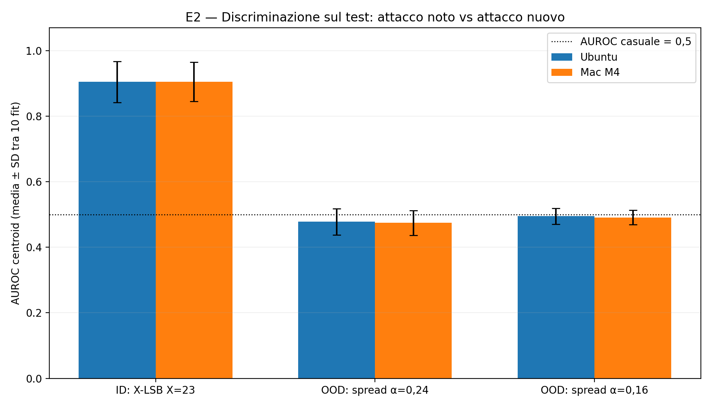
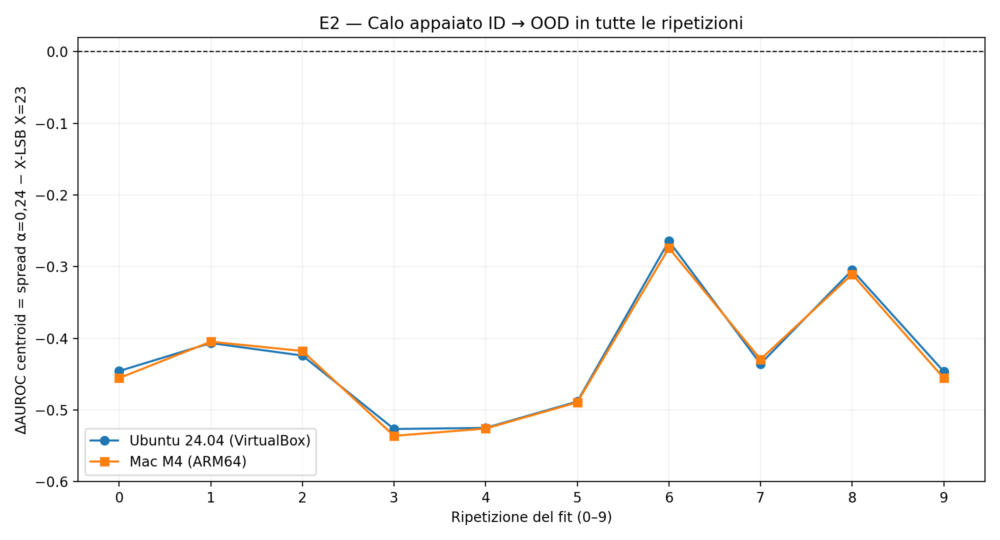
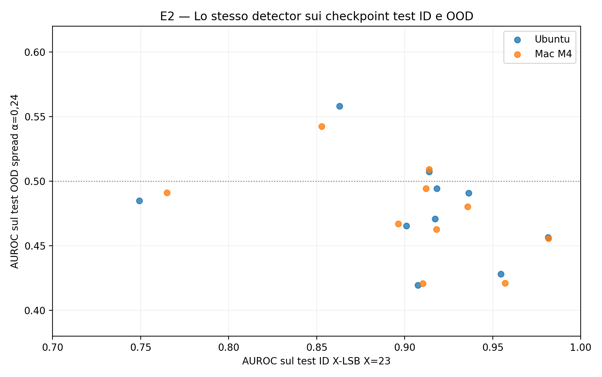

# Beyond the X-Ray — Relazione integrata del progetto di Machine Learning Security

**Esperimenti E1 + E2 | versione consolidata: 22 ottobre 2026**
**Autori del lavoro sperimentale:** Riccardo e Fabrizio
**Ambito:** progetto universitario per la sessione di dicembre 2026; percorso di tesi magistrale individuale (2027) distinto, eventuale paper successivo non incluso nella consegna.
**Repository di lavoro:** `PROGETTO-MACHINE-LEARNING-SECURITY`, branch `ricky`, risultati E2 archiviati nel commit `ee2dd82`.

> **Risultato essenziale.** Sullo zoo GHRP/STL10 di 1.000 CNN autentiche, un detector Siamese Model X-Ray addestrato su soli **tre checkpoint benigni e tre derivati X-LSB X=23** rileva l'attacco noto in test con **AUROC centroid media 0,9043** in entrambe le piattaforme. Quando lo *stesso detector per fit*, senza riaddestramento e senza nuova calibrazione, incontra un embedding **spread-spectrum sintetico a 16 bit** non visto in training, l'AUROC scende a **0,4776 Ubuntu** e **0,4745 Mac M4** per α=0,24. **ΔAUROC OOD−ID = −0,4267 Ubuntu, −0,4298 Mac.** Le due tecniche non sono matched per norma relativa o capacità: il risultato misura questo shift sperimentale, non una proprietà universale di MaleficNet o della steganografia.

## Sintesi dell'impianto sperimentale

| Fase | Domanda | Configurazione | Risultato/Stato |
|---|---|---|---|
| **E1 — Baseline ID** | Il detector riconosce X-LSB su identità mai usate nel training? | X ∈ {1,8,16,23}; 10 ripetizioni per X, train 3+3 | A X=23: AUROC centroid **0,901863 Ubuntu**, **0,904378 Mac**. |
| **E2 — Attack-family shift** | La detection trasferisce a embedding non visto? | Train/val LSB X=23; test ID LSB vs OOD spread α=0,24/0,16; 10 fit | **ΔAUROC primario −0,426652 Ubuntu, −0,429800 Mac**. |
| **E3 — Controlli futuri** | La caduta dipende dalla famiglia, dall'intensità o da altre scorciatoie? | Attacchi e perturbazioni non-stego matched; nuovi zoo | **Non eseguito**: proposte preregistrabili, non risultati. |

### Guida alla lettura e stato delle fonti

Il presente documento **prosegue il report E1 esistente**. La **Parte I** ne preserva la metodologia, i valori e il percorso sperimentale, aggiornando soltanto i riferimenti temporali a E2 dove sono diventati superati. La **Parte II** aggiunge l'intero esperimento E2: motivazione, differenze fra famiglie di embedding, implementazione concreta, gate G1–G7, audit, risultati, limiti e riferimenti. I due esperimenti sono **un lavoro di corso**, non un articolo scientifico già pubblicato dagli studenti.

La base E1 impiegata è la copia completa disponibile del documento `exam/E1_REPORT.md`/`.docx`, con audit hardware Ubuntu/Mac. **Non è stato possibile leggere direttamente la versione più recente di `exam/` dal server GitHub** durante la composizione; per questo il nuovo report viene consegnato come `exam/PROJECT_REPORT.md` e `exam/PROJECT_REPORT.docx`, **senza sostituire o cancellare** `exam/E1_REPORT.*`. Prima del commit è opportuno confrontare la Parte I con l'E1 locale della branch `ricky`.

---

## PARTE I — E1: rilevamento in-distribution di embedding LSB su pesi reali di CNN

**Progetto:** Beyond the X-Ray — Machine Learning Security, lavoro condiviso Riccardo–Fabrizio.
**Chiarimento:** «due architetture» qui indica le **piattaforme di calcolo** (Ubuntu/CPU x86_64 virtualizzata e macOS/ARM64 M4), **non due architetture differenti di reti CNN**. Il dataset e il protocollo E1 rimangono gli stessi.
**Chiusura su Ubuntu:** 19 ottobre 2026. **Replica cross-platform ricevuta:** 20 ottobre 2026. **Stato storico al 20 ottobre:** E1 completato e replicato; **aggiornamento del 22 ottobre:** E2 ora completato (Parte II), E3 non ancora eseguito.
**Risultati Ubuntu versionati:** commit [`d35f8f2`](https://github.com/riccardodannibale/PROGETTO-MACHINE-LEARNING-SECURITY/commit/d35f8f2), branch `ricky`. **Replica Fabrizio:** file `results/replicas/e1_mac_m4/`; commit Mac `59f556c` (diff dei file esecutivi dichiarato vuoto da Fabrizio; hash SHA-256 del runner verificato).
**Metodologia:** protocollo *few-shot* adattato da Model X-Ray; non replica numerica esatta delle tabelle pubblicate dagli autori.

> **Risultato sintetico.** Sul test interno con checkpoint sorgente distinti, il detector *centroid* raggiunge, a **X=23**, AUROC media **0,901863 su Ubuntu x86_64** e **0,904378 su Mac M4 ARM64**, entrambe su 10 ripetizioni. Accuracy con soglia scelta esclusivamente sulla validation: **82,125% su Ubuntu** e **82,300% su Mac**. Per X=1,8,16 l'AUROC è prossima a 0,5. Questo **risultato E1**, preso isolatamente, non costituisce una dimostrazione di generalizzazione OOD né di attacco steganografico funzionalmente indisturbato.

---

### 1. Background, contesto e research question

#### 1.1 Problema di sicurezza

I checkpoint di machine learning sono file utilizzati per distribuire modelli pre-addestrati e aggiornamenti. Oltre alla sicurezza del codice di caricamento, interessa l'**integrità numerica dei parametri**: contenuto estraneo può essere incorporato nei bit di rappresentazione dei pesi. Gli embedding *X-LSB* sostituiscono X bit meno significativi della mantissa di valori float32. L'intensità controlla la quantità di informazione alterata, ma un embedding più intenso può aumentare anche la perturbazione dei parametri e rendere l'attacco più facilmente rilevabile.

Model X-Ray è il punto di partenza metodologico. Il suo codice implementa trasformazioni/representations dei pesi, uno schema few-shot Siamese e baseline. La letteratura contempla già setting in-distribution e OOD; il presente lavoro di corso mira prima di tutto a una **misurazione controllata e riproducibile**, non a rivendicare la scoperta del problema o un nuovo detector.

#### 1.2 Obiettivo del progetto complessivo

La domanda è: **un detector basato su Model X-Ray riproduce un comportamento misurabile in-distribution e come si comporta con embedding di famiglie non viste, mantenendo controlli rigorosi sui confondenti?** Per isolare la risposta abbiamo separato il programma in:

| ID | Scopo | Train | Valutazione | Stato |
|---|---|---|---|---|
| **E1 — ID** | Stabilire baseline robusta su attacco noto. | LSB su CNN del dataset selezionato. | LSB su checkpoint mai usati nell'addestramento, stesso zoo. | **Concluso**, 40 validation + 40 test, v2. |
| **E2 — OOD attack shift** | Misurare generalizzazione a una famiglia di embedding non vista. | LSB, come E1. | Nuova famiglia di embedding; evitare cambi di architettura e attack family simultanei. | **Completato in seguito**, 22 ottobre 2026; risultati in Parte II. |
| **E3 — controlli** | Cercare scorciatoie e leakage. | Protocollo matched. | Bilanciamento, provenance, serializzazione/metadati, altri fattori confondenti. | **Pianificato**, con alcune garanzie di base già in E1. |

Al momento della redazione originale E1, E2 ed E3 non erano ancora risultati acquisiti. La Parte II, redatta dopo il completamento di E2, riporta ora i risultati effettivamente ottenuti; E3 resta da realizzare. L'eventuale percorso di tesi individuale e un possibile paper sono distinti dalla consegna dell'esame.

#### 1.3 Obiettivo specifico E1 e ipotesi

Dato un classificatore few-shot addestrato con **tre coppie** benign/stego ricavate da CNN originali, misurare la capacità di distinguere nuove CNN benign da CNN stego su **identità non viste**, in quattro intensità X-LSB: **1, 8, 16, 23**. L'ipotesi esplorata è che la detection aumenti per alterazioni molto invasive, mentre per X bassi il segnale potrebbe non essere distinguibile dal rumore della rappresentazione. Prima del test è stato congelato **centroid/AUROC come confronto primario**, con 1-NN e metriche a soglia come secondarie.

### 2. Dataset, provenienza e preparazione

#### 2.1 Origine delle CNN

Sono stati utilizzati **1.000 checkpoint autentici di CNN** provenienti dallo zoo GHRP/STL10, scaricato dalla raccolta [Zenodo 6631784](https://zenodo.org/records/6631784). Una prima verifica ha evidenziato che `dataset.pt` rappresentava immagini STL10, e non poteva essere trattato come vettore di pesi per la detection: l'estrazione iniziale da immagini è stata scartata. La pipeline corretta `scripts/extract_d1_real_weights.py` ha estratto veri pesi dei checkpoint, ottenendo `weights.npy` di forma **(1000,2864)** e dtype **float32**. La provenienza è registrata in `checkpoint_manifest.csv` e `extraction_summary.json` locali.

L'uniformità delle 1.000 CNN consente un test ID a rappresentazione coerente ma **limita le conclusioni alla distribuzione analizzata**.

#### 2.2 Split e unità statistica

Il protocollo congelato `manifests/e1_uniform_v1/{splits.csv,protocol.json}` assegna **600 checkpoint al pool train, 200 alla validation e 200 al test**. Ogni replica estrae tre identità dal pool train, con campioni benign e stego appaiati per identità. I derivati di un checkpoint non attraversano gli split.

| Elemento | Quantità |
|---|---:|
| CNN originali distinte nel dataset | 1.000 |
| Pool train disponibile | 600 |
| Checkpoint sorgente per singolo training few-shot | **3** |
| Campioni effettivi per training | **6** (3 benign + 3 stego) |
| Checkpoint distinti di validation | 200 |
| Osservazioni per validation e replica | **400** (200 + 200) |
| Checkpoint distinti di test | 200 |
| Osservazioni per test e replica | **400** (200 + 200) |
| Ripetizioni per X | 10 |
| Livelli X-LSB | 1, 8, 16, 23 |
| Fit per campagna | **40** |

I campioni benign/stego di una stessa CNN sono correlati: **400 osservazioni non equivalgono a 400 checkpoint indipendenti**. La prevalenza delle due classi è 50% per costruzione, quindi AUPRC va interpretata rispetto a un riferimento casuale vicino a 0,5.

#### 2.3 Assenza di leakage diretto e limite dello stesso zoo

Il runner verifica hash e identità dei checkpoint, lo split per sorgente e che la soglia sia scelta sulla validation. La partizione test non è stata letta durante il *preflight*. Ciononostante, alcune prove esplorative precedenti al congelamento del protocollo hanno coinvolto lo stesso zoo: il test è una **valutazione interna con checkpoint disgiunti**, non una validazione esterna completamente incontaminata. Il solo uso della parola “blind” non elimina questo limite.

### 3. Threat model e costruzione degli esempi

#### 3.1 Attacco sintetico

Per ciascun checkpoint si prende un vettore float32 benign. Si applica l'algoritmo `img_pp_xlsb_attack` di Model X-Ray per sovrascrivere **X bit meno significativi della mantissa** di ciascun peso con bit ricavati da un payload. I payload sono **byte pseudo-casuali sintetici, inerti e non eseguibili**. Non è stata effettuata esecuzione di malware né verificata l'operatività di un trojan.

In v2 ogni checkpoint ha un payload diverso ma riproducibile. Il runner genera **16.384 byte** tramite **SHA-256 per derivare il seed** e **PCG64 NumPy** per produrre byte uniformi. La chiave combina schema, seed 42, ripetizione, X e `row_index`. Il file binario temporaneo viene passato all'attacco upstream e poi eliminato; `payload_manifest.csv` registra gli SHA-256 dei payload generati.

#### 3.2 Paired design e rappresentazione

Per ogni checkpoint si costruiscono una cover (`X=0`) e una versione stego (`X∈{1,8,16,23}`), quindi si usa la rappresentazione immagine **gf**, dimensione **100×100**, della pipeline upstream. L'uso della medesima sorgente per benign/stego riduce il rischio che il detector riconosca l'origine invece dell'attacco. Non dimostra da solo l'assenza di scorciatoie legate alla trasformazione: queste verranno approfondite in E3.

### 4. Modello, protocollo di valutazione e metriche

#### 4.1 Detector few-shot

Il modello è il Siamese CNN originale di Model X-Ray (`train_fsl`, architettura `osl_siamese_cnn`, modalità `ub`) richiamato dal nostro runner. L'upstream è fissato al commit **`a880e332f556fc71faf8d3753931005d5d019339`**; non sono state editate le sue sorgenti. Lo stesso embedding appreso alimenta due classificatori:

- **Centroid (primario):** distanza euclidea fra l'embedding di un checkpoint e la media degli embedding di train di ciascuna classe.
- **1-NN (secondario):** distanze euclidee dai campioni few-shot di train, considerando il vicino più prossimo di ciascuna classe.

Lo score è il margine `d(benign) - d(stego)`: **score > 0** favorisce stego. Le predizioni ricavate dal margine sono controllate rispetto alle funzioni d'inferenza upstream; eventuali discordie interrompono l'esperimento.

#### 4.2 Threshold e separation of duties

Riportiamo due politiche di decisione binaria:

1. **`original_zero`**: soglia fissa `0` sul margine.
2. **`val_youden`**: soglia selezionata massimizzando l'indice di Youden `TPR−FPR` **esclusivamente sui 200 checkpoint validation** di ciascuna replica.

AUROC e AUPRC sono metriche di ranking, quindi **non cambiano** tra le due soglie. Per il test, il Siamese viene **riaddestrato** con lo stesso protocollo e seed; per quel nuovo modello la soglia è calcolata sui campioni di validation e applicata al test **senza scegliere la soglia sulle etichette test**. Poiché i pesi del detector della validation precedente non sono stati salvati, la ricalibrazione sul nuovo modello era necessaria: le due campagne di validation non vanno confuse.

Metriche: accuracy; AUROC (primaria, centroid); AUPRC; precision, recall, F1; tasso falsi positivi (`FPR=FP/(FP+TN)`). Il file `metrics_per_run.csv` comprende altre metriche come balanced accuracy, specificità e conteggi per classe. I riepiloghi riportano media su **10 repliche** e deviazione standard dell'accuracy. **Non abbiamo calcolato intervalli di confidenza cluster-aware né riportato deviazioni standard AUROC nel riepilogo.**

#### 4.3 Setup computazionale

Esperimenti eseguiti su **Ubuntu 24.04 in VirtualBox**, CPU (senza GPU), **6 vCPU**, circa **11 GiB RAM** e **4 GiB swap**. Ambiente Python 3.11 locale con pacchetti congelati (`configs/modelxray-ubuntu24-py311.lock.txt`). Per contenere l'uso di memoria, ogni training del runner v2 viene eseguito in un **processo separato** e può essere ripreso senza sovrascrivere i run conclusi.

### 5. Sviluppo dell'esperimento: piloti, diagnosi e freeze

Il percorso sperimentale è documentato per evitare la falsa impressione che il protocollo finale sia stato scelto retroattivamente in base al test.

| Campagna | Obiettivo, osservazione | Decisione |
|---|---|---|
| **Pilot upstream** | 8 combinazioni rapide (4 X × 2 repliche). Centroid ~50% per X≤16, ~84,75% per X=23. | Segnale promettente, ma protocollo non sufficiente come valutazione finale. |
| **Pilot paired** | 4 combinazioni (X16 e X23 × 2 repliche), 3 sorgenti train e 300 sorgenti test pilota. Centroid ~49,58% X16 e ~85,00% X23. | Usare esempi benign/stego matched e split congelati. |
| **Freeze split** | Manifest train/validation/test 600/200/200, checkpoint IDs/hashes e dimensioni verificati. | Non cambiare la partizione per migliorare i risultati. |
| **Validation v1 (esplorativa)** | 40 run con attacco casuale interno; centroid AUROC media ~0,870 per X23. | Mancava ricostruibilità esatta dei payload: conservare separata, non usare come risultato definitivo. |
| **Diagnosi riproducibilità** | Senza attacco l'immagine è stabile. `PayloadType.RANDOM` produce output diversi a seed NumPy globale uguale; file binario temporaneo riproduce output identici. | Generazione deterministica per checkpoint e controllo hash dei payload. |
| **Smoke v2** | X23, replica 0, modalità `es`; 800 righe predizioni (2 metodi × 400 esempi), 203 payload diversi (3 train+200 val), AUROC centroid ~0,861. | V2 funzionante; smoke non comparabile come fit definitivo `ub`. |
| **Validation v2 finale** | 40/40 training `ub`; primo arresto a 32/40 per 1 discordanza numerica centroid su 400 campioni al livello X1. | Diagnostica separata senza discordie, una riesecuzione mirata documentata; completate 40/40 prove. |
| **Freeze protocollo test** | Script di test versionato, `--preflight` 40/40, Git pulito, scelta primario fissata. | Eseguire test su 200 identità riservate, senza tuning successivo. |
| **Test v2 finale** | 40/40 run isolati; metriche validation e test correttamente salvate e controllate; commit `d35f8f2`. | E1 chiuso; risultati non modificati in risposta alle prestazioni del test. |

**Nota su riproducibilità:** i *payload* v2 sono riproducibili per construction. Il *training TensorFlow* con uguali seed potrebbe non essere bitwise deterministico. Il caso di discordanza vicino a score zero e la ripetizione controllata riguardavano la **validation**, prima del test; non è stata provata una perfetta stabilità numerica del classificatore.

### 6. Risultati quantitativi

#### 6.1 Validation v2 di sviluppo (40 fit)

| X | AUROC centroid | Accuracy centroid, soglia 0 | Accuracy centroid, Youden (sulla stessa validation) |
|---:|---:|---:|---:|
| 1 | 0,500213 | 0,49925 | 0,50825 |
| 8 | 0,493719 | 0,49125 | 0,52800 |
| 16 | 0,504950 | 0,49950 | 0,53400 |
| **23** | **0,882645** | **0,79000** | **0,81800** |

Le accuracy `val_youden` di questa tabella sono **valori di sviluppo stimati sullo stesso split di calibrazione**; non vanno presentati come prestazione finale indipendente. La metrica di ranking AUROC è uguale per entrambe le politiche.

#### 6.2 Test interno riservato: risultati principali (40 fit)

**Centroid — 10 ripetizioni per intensità.**

| X-LSB | AUROC test media | AUPRC test media | Accuracy test soglia 0 (media ± SD) | Accuracy test soglia Youden (media ± SD) | FPR test Youden |
|---:|---:|---:|---:|---:|---:|
| 1 | 0,500150 | 0,504064 | 0,50075 ± 0,00265 | 0,50025 ± 0,00142 | 0,5180 |
| 8 | 0,508232 | 0,509345 | 0,50150 ± 0,02015 | 0,50375 ± 0,01831 | 0,4315 |
| 16 | 0,501293 | 0,512234 | 0,49800 ± 0,01490 | 0,49850 ± 0,00835 | 0,3735 |
| **23** | **0,901863** | **0,902063** | **0,80375 ± 0,06920** | **0,82125 ± 0,07030** | **0,1550** |

La SD è la **deviazione standard campionaria delle accuracy tra 10 fit** (non un IC al 95%). I checkpoint test sono gli stessi tra repliche, quindi non trattiamo queste osservazioni come 10 test esterni indipendenti.

#### 6.3 Confronto con la validation eseguita all'interno della campagna test

| X | AUROC centroid validation della campagna test | AUROC centroid test | Differenza test − validation |
|---:|---:|---:|---:|
| 1 | 0,500195 | 0,500150 | −0,000045 |
| 8 | 0,496286 | 0,508232 | +0,011946 |
| 16 | 0,504028 | 0,501293 | −0,002735 |
| **23** | **0,881812** | **0,901863** | **+0,020051** |

Questi dati derivano dagli **stessi fit della campagna test**: il sottoinsieme validation serve a determinare la soglia del relativo modello. Non confonderli con la validation di sviluppo, pubblicata separatamente.

#### 6.4 Confronto con il metodo secondario 1-NN

| X | AUROC centroid test | AUROC 1-NN test | Δ centroid − NN |
|---:|---:|---:|---:|
| 1 | 0,500150 | 0,500190 | −0,000040 |
| 8 | 0,508232 | 0,498930 | +0,009302 |
| 16 | 0,501293 | 0,500670 | +0,000623 |
| **23** | **0,901863** | **0,815734** | **+0,086129** |

Al livello X23 centroid mostra una maggiore AUROC media rispetto al metodo 1-NN in questo setup. Essendo un confronto secondario, occorrerebbe analizzare le differenze **appaiate tra repliche** e relative incertezze prima di attribuire significatività statistica al divario.

#### 6.5 Analisi accuracy/FPR a X23

Per il classificatore centroid sul test, passando da soglia 0 a soglia Youden calibrata sulla validation:

| Metrica | Soglia 0 | Soglia validation Youden |
|---|---:|---:|
| Accuracy media | 0,80375 | **0,82125** |
| F1 media | 0,793623 | **0,812583** |
| FPR medio | 0,1705 | **0,1550** |
| AUROC media | 0,901863 | 0,901863 |
| AUPRC media | 0,902063 | 0,902063 |

La calibrazione migliora leggermente accuracy e FPR medi a X23 sul test, **non** la capacità di ranking del detector. Per X≤16, la scelta di soglia non rende AUROC migliore di ~0,5 e può modificare sensibilmente FPR senza vera separazione.

#### 6.6 Figure pronte per GitHub e file Excel

- **Figura 1:** [AUROC vs intensità X — validation di sviluppo, validation dei fit test, test](../results/figures/e1/e1_auroc_val_test.png).
- **Figura 2:** [Accuracy test — soglia originale vs Youden](../results/figures/e1/e1_accuracy_thresholds.png).
- **Figura 3:** [FPR test — soglia originale vs Youden](../results/figures/e1/e1_fpr_thresholds.png).
- **Figura 4:** [Confronto AUROC centroid vs NN sul test](../results/figures/e1/e1_auroc_centroid_nn.png).
- **Workbook editabile con grafici Excel nativi:** [E1_grafici.xlsx](../results/figures/e1/E1_grafici.xlsx).

Le figure allegate sono state predisposte usando i **valori dei riepiloghi CSV condivisi nei log**; per la verifica finale vanno **rigenerate sui CSV realmente versionati** con `scripts/plot_e1_results.py` prima del commit. Non ricostruirle a mano cambiando cifre o aggregazioni. Lo script non esegue training.

### 7. Replica di Fabrizio su Mac M4 — confronto delle piattaforme

#### 7.1 Che cosa rappresenta il confronto e cosa NON rappresenta

**Confronto originale → Ubuntu → Mac.** Il lavoro originale **Model X-Ray** è il riferimento metodologico e di codice; i suoi risultati pubblicati derivano da condizioni che non sono state qui accertate come identiche al nostro protocollo e **non sono collocati in una tabella quantitativa comune**. Il **pilot upstream originale** e la **validation esplorativa E1 v1** rappresentano invece fasi interne di sviluppo, non un terzo test finale indipendente. I soli risultati direttamente accostati nella tabella seguente sono le due esecuzioni E1 v2 con dati e split corrispondenti.

**Riccardo:** Ubuntu 24.04 su VirtualBox, CPU x86_64, 6 vCPU, ~11 GiB RAM, 4 GiB swap. **Fabrizio:** macOS su Apple Silicon **M4 ARM64**, TensorFlow su CPU (Metal non attivato), Python 3.11.17, NumPy 1.26.4, TensorFlow 2.15.1, PyTorch 2.4.0; nessuna GPU TensorFlow visibile. Non sono due architetture **neuronali**: le 1.000 CNN sorgente hanno la stessa rappresentazione in entrambi i run.

Integrità dichiarata e confrontabile:

- `weights.npy` SHA-256: `5a03ff6349010405fd05c7c27aee746143259fdf0a000acb4c9e05cbc8dd60ad`.
- `splits.csv` SHA-256: `3f4236bf2b3e7a91e11dd67037c5dc3262382fd8c77ce333b49f30d6e4b93a6f`.
- Upstream Model X-Ray fissato a `a880e332f556fc71faf8d3753931005d5d019339`.
- Payload v2 sintetici deterministici; 203 payload/identità nello smoke test Mac; 40/40 validation e 40/40 test dichiarati e coerenti con i CSV.

**Versioning e integrità aggiornati (audit 20 ottobre).** Il `project_commit` del test Ubuntu è `f5bf86b237ca61f1d845732be41aa24203855921`; quello Mac è `59f556c78c8f7b0f1dac60bbe41748415ac0a71b`. Fabrizio ha eseguito `git diff` sui file sperimentali e **riferisce che il diff è vuoto**; l’output testuale del diff non è incluso nell’archivio ricevuto. Separatamente, è stato verificato l’hash SHA-256 del runner conservato tra gli artefatti di lavoro: `a75aa3d844bb695a6d6155fe808394025b04c480d74d1e1b856eec5ca6f9c037`, coincidente con quello comunicato da Fabrizio. L’upstream e gli SHA di pesi e split coincidono nei `run_config.json` Mac. La conformità del runner non implica training bitwise-identico né consente di attribuire causalmente i residui al processore.

#### 7.2 Risultati test E1 v2 — centroid (10 ripetizioni per X)

| X-LSB | AUROC Ubuntu x86_64 | AUROC Mac ARM64 | Δ Mac − Ubuntu | Accuracy Youden Ubuntu | Accuracy Youden Mac | FPR Youden Ubuntu | FPR Youden Mac |
|---:|---:|---:|---:|---:|---:|---:|---:|
| **1** | 0.500150 | 0.500209 | +0.000059 | 0.50025 | 0.50075 | 0.5180 | 0.4595 |
| **8** | 0.508232 | 0.509388 | +0.001156 | 0.50375 | 0.50350 | 0.4315 | 0.4605 |
| **16** | 0.501293 | 0.501425 | +0.000132 | 0.49850 | 0.50125 | 0.3735 | 0.3470 |
| **23** | 0.901863 | 0.904378 | +0.002515 | 0.82125 | 0.82300 | 0.1550 | 0.1605 |

Sono medie sui **200 checkpoint di test distinti** per ciascuna replica, con 200 versioni benign e 200 stego. La soglia Youden è scelta nella validation dello stesso fit, **non ottimizzata sul test**. In particolare, a X=23 la differenza di AUROC **Mac − Ubuntu è +0,002515**, e quella di accuracy Youden è **+0,00175** (0,175 punti percentuali). Queste differenze **non dimostrano superiorità del Mac** e non sono un test di significatività statistica.

#### 7.3 Dettagli Mac: validation della campagna test, 1-NN e tempi

| X | AUROC centroid validation nei fit test Mac | AUROC centroid test Mac |
|---:|---:|---:|
| 1 | 0.500254 | 0.500209 |
| 8 | 0.495828 | 0.509388 |
| 16 | 0.502669 | 0.501425 |
| 23 | 0.883028 | 0.904378 |

A X=23, anche il classificatore secondario **1-NN** mantiene segnale di detection: AUROC test **0,815734 Ubuntu** e **0,819226 Mac**. La classifica centroid > 1-NN a X23 è coerente sulle due piattaforme, ma senza un test appaiato dei punteggi non formuliamo una conclusione di significatività statistica.

Fabrizio riporta **circa 100–110 secondi per fit test** su M4, senza OOM, esecuzione in processi isolati e utilizzo di `caffeinate` per evitare la sospensione del Mac. Questo è un dato operativo riferito alla sua macchina, non un benchmark hardware scientificamente controllato. Su Ubuntu era stato necessario introdurre l'isolamento per processo dopo un OOM nel precedente runner v1.

#### 7.4 Verifiche eseguite sugli allegati e lacune residue

Il pacchetto ricevuto contiene `summary.csv` (32 righe: 16 validation + 16 test), `metrics_per_run.csv` (320 righe: 160 + 160) e `e1_v2_test.log`. Abbiamo ricalcolato direttamente dai 320 record tutte le medie di accuracy, AUROC, AUPRC, F1 e FPR riportate in `summary.csv` e verificato **40 coppie (replica, X) per ognuno dei due stage**.

**Materiali integrativi ora ricevuti e verificati.** Sono disponibili i `run_config.json` Mac di test e validation stand-alone, il relativo `validation_standalone_summary.csv`, il `payload_manifest_r00_x23.csv` (3 train + 200 validation + 200 test, 403 righe) e `mac_environment.txt`. Tutti e 403 gli SHA-256 dei payload sono stati **rigenerati indipendentemente** tramite lo schema `sha256-keyed-uint8-pcg64-per-model-v1` e coincidono. Le medie nel `summary.csv` della campagna test corrispondono ai 320 record Mac già presenti. Mancano tuttora il log per-run della validation stand-alone e il manifest payload Ubuntu corrispondente per un confronto riga-per-riga fra macchine. Il file ambiente Mac registra chip M4 10-core, 16 GB e macOS 27.0.1, ma mostra errori di shell durante il recupero delle versioni delle librerie: per Python/NumPy/TF restano validi i valori **dichiarati** nel resoconto precedente, non un rilevamento completo dal nuovo file.

#### 7.5 Grafici del confronto fra piattaforme

- [AUROC Ubuntu vs Mac, centroid](../results/figures/e1/e1_platform_auroc.png).
- [Accuracy test con Youden, Ubuntu vs Mac](../results/figures/e1/e1_platform_accuracy_youden.png).
- [FPR test con Youden, Ubuntu vs Mac](../results/figures/e1/e1_platform_fpr_youden.png).
- [AUROC centroid vs 1-NN sulle due piattaforme](../results/figures/e1/e1_platform_methods.png).
- [Validation nei fit test e test, due piattaforme](../results/figures/e1/e1_platform_validation_test.png).
- [Excel unico E1, foglio **Confronto_piattaforme** con grafici modificabili](../results/figures/e1/E1_grafici.xlsx).

**Conclusione della replica:** il comportamento qualitativo E1 è riprodotto su due piattaforme CPU differenti, a parità degli hash di pesi e split e con risultati quantitativi prossimi. Ciò rafforza la credibilità operativa del benchmark **ID** ma non è una prova di generalizzazione a CNN di altra architettura, né garantisce uguaglianza bitwise.

---


#### 7.6 Audit finale dei file ricevuti (20 ottobre 2026)

L’ultimo archivio consegnato da Fabrizio è acquisito **senza sovrascrivere i CSV finali già versionati**. La cartella `results/replicas/e1_mac_m4/audit/` comprende cinque sorgenti originali: `run_config_test.json`, `run_config_validation.json`, `validation_standalone_summary.csv`, `payload_manifest_r00_x23.csv` e `mac_environment.txt`, oltre ai riepiloghi derivati `platform_summary_aggregates.csv` e `audit_integrity.json`.

**Riscontri indipendenti:**

- I due `run_config.json` riportano gli stessi `weights_sha256`, `splits_sha256`, `upstream_commit`, seed 42, schema payload, lista X e parametri sperimentali; gli stage correttamente distinti sono `test` e `validation`. Il commit locale Mac differisce fra le due campagne, come registrato nei singoli file.
- Il runner `run_e1_final_v2.py` della copia di lavoro fornita produce SHA-256 `a75aa3d844bb695a6d6155fe808394025b04c480d74d1e1b856eec5ca6f9c037`, lo stesso comunicato da Fabrizio per i due commit test. Fabrizio dichiara **diff vuoto sui file di esecuzione**; conservare output e comandi del diff in caso di review tecnica.
- Il manifest `repeat=0`, `X=23` contiene **403 righe**: 3 train, 200 validation, 200 test. Tutti i **403 digest SHA-256 del payload** sono stati ricalcolati con seed per `row_index` e NumPy PCG64: **403/403 corrispondenze**. Ciò prova l’integrità del manifest rispetto allo schema, non una corrispondenza riga-per-riga con il manifest Ubuntu (non allegato).
- Il `validation_standalone_summary.csv` contiene **16 righe** (4 X × 2 metodi × 2 politiche) e dichiara 10 ripetizioni per configurazione. A X=23, metodo centroid, **AUROC Mac validation stand-alone = 0,882700**. La validation dentro i *fit test* Mac misura invece **0,883028**: non sono la stessa campagna. Il riepilogo della validation separata è disponibile, ma i relativi per-run non sono stati inclusi nell'ultimo ZIP.
- Il Mac ha **16 GB di RAM e 10 core CPU** (4 performance + 6 efficiency); il file ambiente registra macOS `27.0.1`, chip Apple M4 e `arm64`. Alcuni comandi della raccolta software sono falliti (`zsh: permission denied`), quindi il file non documenta da solo in modo esaustivo Python, NumPy e TF storici.

#### 7.7 Analisi descrittiva dei tempi e limiti hardware

| Indicatore | Ubuntu 24.04 VirtualBox | Mac M4 CPU |
|---|---:|---:|
| Fit della campagna test distinti | 40 | 40 |
| `elapsed_sec` medio per fit | **217,124 s** | **104,412 s** |
| Totale dei 40 intervalli cronometrati | ~144,75 minuti | ~69,61 minuti |
| Rapporto delle medie Ubuntu/Mac | **2,079** | riferimento |
| Tempo end-to-end dell’intero processo | Non misurato | Non misurato |
| Picco memoria confrontabile | Non misurato | Non misurato |

La fonte dei tempi Ubuntu è l’**audit già eseguito sulla macchina di Riccardo** il 20 ottobre, con 40 fit deduplicati. La media Mac è stata anche ricalcolata dai 40 `elapsed_sec` univoci del CSV originale. `elapsed_sec` misura il tratto del runner cronometrato dopo una parte della preparazione dei dati e non include l'avvio Python: **non** può essere chiamato tempo end-to-end. Il rapporto **2,079** descrive il confronto tra *due ambienti storici*, non misura il vantaggio causale del chip M4; differiscono virtualizzazione, CPU, RAM, OS, build e possibili impostazioni di threading.

Le differenze tra le **medie** delle AUROC si possono calcolare dai `summary.csv` (X23, Mac−Ubuntu = **+0,0025145**), ma la **dispersione delle differenze paired** richiede tutte e dieci le coppie di record Ubuntu e Mac. Sulla VM di Riccardo `scripts/audit_e1_platforms.py` ha già prodotto `paired_per_run.csv`, `metrics_by_x.csv`, `timing_by_x.csv` in `~/mlsec-local/audits/e1_hardware_comparison/`. Per completare un eventuale supplemento statistico nel repository, importare questi tre CSV senza alterare i test originali. Le coppie condividono le stesse identità di test e non sono campioni esterni indipendenti: un IC bootstrap sui soli 10 fit, se calcolato, descriverebbe la variabilità *dei fit condizionata a questo zoo*, non la generalizzazione a nuovi zoo.

**Decisione operativa:** l’esperimento E1 è sufficientemente documentato e replicato per passare alla progettazione di E2. Un nuovo benchmark controllato di memoria/wall-clock può essere svolto in un’appendice separata, ma non è necessario ripetere 40 fit né riaprire il test E1.

Figure aggiuntive: `e1_hw_auroc_comparison.png`, `e1_hw_mac_elapsed_by_x.png`, `e1_hw_mac_runs_auroc.png`. Workbook `E1_grafici.xlsx`: fogli aggiunti `Audit_hardware` e `Mac_val_standalone` (i 9 grafici precedenti sono conservati; sono stati aggiunti 2 grafici Excel nativi).

### 8. Discussione

**Messaggio principale.** La replica Mac M4 conferma qualitativamente la baseline Ubuntu, con AUROC X23 rispettivamente 0,904378 e 0,901863. Nel setting E1 il metodo centroid discrimina bene campioni benign/stego quando si sovrascrivono **23 bit di mantissa** (AUROC media ~0,902), ma ha un comportamento vicino al caso per **X=1,8,16** (AUROC 0,500–0,508). Questo è un risultato sul **particolare zoo e protocollo few-shot** studiati, non una misura universale di efficacia contro stegomalware.

La forte transizione a X23 è compatibile con un cambiamento molto più pronunciato della distribuzione dei pesi. Dal solo risultato di detection **non** possiamo inferire che un payload X23 mantenga inalterata l'utilità dei CNN, sia furtivo, venga recuperato esattamente o rappresenti malware eseguibile. Analogamente, il risultato quasi-casuale a X≤16 non prova che ogni possibile detector fallirebbe.

**Generalizzazione.** La robustezza ID misurata non dice come il detector reagisce ad attacchi di famiglia diversa (E2) né a cambi di architettura, serializzazione o lifecycle (E3 e possibili approfondimenti di tesi).

**Statistica.** La media sulle 10 ripetizioni descrive la variabilità del training e dei payload, ma un'inferenza rigorosa sul mondo esterno dovrebbe rispettare l'accoppiamento benign/stego e l'unità indipendente **checkpoint di origine**. Non attribuiamo p-value, intervalli di confidenza o differenze significative non calcolate.

### 9. Limiti e validità delle conclusioni

1. **Un solo zoo, un'architettura/popolazione di checkpoint.** Anche il Mac M4 misura lo stesso zoo e non aumenta la diversità di architettura neurale; validità esterna non dimostrata.
2. **Checkpoint test identity-disjoint ma non zoo-disjoint** e precedente esplorazione del medesimo zoo. Non chiamare il test incontaminato in senso assoluto.
3. **Few-shot estremo:** 3 identità train (6 osservazioni), 10 repliche; risultati sensibili alla casualità di training, specialmente vicino a score zero.
4. **Precisione numerica:** un run della validation v2 si è fermato per 1/400 discordanza fra margine e inferenza upstream; diagnostica successiva 0/400. Non è stato dimostrato il determinismo TensorFlow bit-a-bit.
5. **Payload deterministici ≠ payload malware reale.** Byte inerti pseudo-casuali, non eseguibili; assenza di test di utility/recupero.
6. **Soglia Youden della validation.** Le accuracy Youden misurate sulla medesima validation sono ottimistiche; solo il test successivo supporta una valutazione indipendente della soglia.
7. **Classi bilanciate al 50%.** AUPRC dipende dalla prevalenza; deployment con prevalenze differenti richiede una valutazione specifica.
8. **Incertezza limitata.** Nella tabella di sintesi è disponibile SD dell'accuracy; non sono stati stimati IC cluster-aware e TPR@FPR molto basse non sarebbero giustificati da 200 benign test.
9. **Solo detection.** Attacco fattibile, recovery, execution, degrado di accuracy CNN e compromissione reale dei modelli non misurati.
10. **Confronto fra piattaforme.** Commit Mac e Ubuntu differenti; assenza di full run_config/manifest Mac e validation stand-alone allegata; nessuna prova che le piccole differenze siano causate unicamente da CPU o sistema operativo.

### 10. Conclusione E1 e collegamento a E2/E3

E1 conclude una **baseline sperimentale replicata su Ubuntu CPU x86_64 e Mac M4 CPU ARM64** su 1.000 checkpoint autentici con split identità-disgiunti, esempi paired, payload sintetici tracciati, 40 fit di validation e 40 fit sul test riservato. In questo regime, **X23 è rilevabile con AUROC media 0,901863 (Ubuntu) e 0,904378 (Mac)** dal centroid few-shot, mentre **X≤16 resta vicino a 0,5**. La calibrazione su validation produce **accuracy media test 0,82125** e **FPR 0,1550** a X23.

La replica cross-platform riproduce il comportamento **a livello aggregato** e non è una prova di equivalenza bitwise o attribuzione causale delle differenze al solo hardware. Il risultato non è una nuova difesa, né dimostra OOD generalization. **E2**, documentato nella Parte II, ha confrontato il detector con un embedding di famiglia diversa non visto nell'addestramento; **E3** verificherà se i risultati resistono a controlli più forti su origine e trasformazioni. Il quadro di ricerca segue criteri di comparabilità e pre-registrazione delle scelte, senza sfruttare il test E1 per decidere retroattivamente i parametri.

### 11. Materiali, riferimenti e provenienza delle affermazioni

**Dati primari** (da usare per qualunque citazione numerica):

- **Replica Fabrizio Mac M4:** `results/replicas/e1_mac_m4/{summary.csv,metrics_per_run.csv,e1_v2_test.log,replication_manifest.md}`. I CSV sono estratti senza modificarli dallo ZIP fornito da Fabrizio e le medie sono state ricontrollate.

- `results/validation/e1_uniform_v2/{summary.csv,metrics_per_run.csv,run_config.json}`.
- `results/test/e1_uniform_v2/{summary.csv,metrics_per_run.csv,run_config.json}`.
- `manifests/e1_uniform_v1/{protocol.json,splits.csv}`.
- I file per-run `metrics.json` e `predictions_{validation,test}.csv` sono conservati nell'area locale `~/mlsec-local/runs/`.

**Codice:** `scripts/run_e1_final_v2.py`, `scripts/run_e1_v2_matrix.sh`, `scripts/run_e1_v2_test_matrix.sh`, `scripts/diagnose_e1_v2_centroid.py` e `external/ModelXRay` (submodule); dipendenze in `configs/modelxray-ubuntu24-py311.lock.txt`.

**Letture:** [Model X-Ray, codice](https://github.com/danigil/ModelXRay); [MaleficNet](https://doi.org/10.1007/978-3-031-17143-7_21); [Do You Trust Your Model?](https://doi.org/10.1109/TDSC.2025.3586703); [GHRP STL10, Zenodo](https://zenodo.org/records/6631784). Le fonti citate in questa bozza richiedono completamento delle voci bibliografiche formali quando si redigerà la relazione d'esame definitiva.

**Attenzione:** i risultati quantitativi di questo documento derivano dalle tabelle `summary.csv` fornite durante l'esecuzione; per aggiungere barre di errore AUROC, IC e curve ROC per checkpoint occorre rileggerne le metriche per-run e predizioni, senza inventare dati.

#### Appendice hardware e riproducibilità

- Audit di dettaglio: [`E1_HARDWARE_FINAL_AUDIT.md`](../docs/E1_HARDWARE_FINAL_AUDIT.md).
- Sorgenti ricevute: [`results/replicas/e1_mac_m4/audit/`](../results/replicas/e1_mac_m4/audit/).
- I risultati Ubuntu e Mac originali restano immutati nelle cartelle `results/test/e1_uniform_v2/` e `results/replicas/e1_mac_m4/`.


---

## PARTE II — E2: generalizzazione a una famiglia di embedding non vista

### 12. Motivazione scientifica: perché E2 dopo E1

**Domanda di ricerca E2.** Un rilevatore few-shot di steganografia nei pesi, addestrato unicamente a riconoscere alterazioni *X-LSB X=23*, mantiene la capacità di separare checkpoint benigni da checkpoint modificati quando la tecnica d'incorporamento cambia, ma rimangono invariati lo zoo di provenienza, l'architettura delle CNN, il protocollo di training e le identità dei checkpoint di valutazione?

E1 aveva fornito una baseline *in-distribution* (ID) riproducibile: con X=23 il metodo centroid discriminava bene, mentre per X=1,8,16 le AUROC erano vicine a 0,5. Questa osservazione, da sola, non prova che il detector abbia appreso un concetto generale di «payload nascosto». Potrebbe aver imparato soprattutto gli artefatti di una particolare manipolazione della rappresentazione numerica. E2 è stato quindi concepito come **esperimento di *attack-family shift***: mantenere costante l'addestramento noto e cambiare la famiglia di incorporamento osservata **solo in valutazione**.

**Punto essenziale:** non abbiamo abbandonato X-LSB e non abbiamo addestrato il Siamese con spread-spectrum. Abbiamo mantenuto **X-LSB X=23 per il training e per la calibrazione**; lo spread-spectrum è entrato come *attacco OOD* nuovo, cioè un tipo di perturbazione mai presentato al detector durante l'apprendimento. Questo permette di chiedersi se le rappresentazioni apprese su LSB si trasferiscano a un meccanismo diverso. Avessimo addestrato il Siamese sullo spread, non avremmo più misurato quella generalizzazione *zero-shot rispetto alla famiglia di attacco*.

Il disegno rimane **condizionato a un solo zoo di CNN**: cambia la famiglia di embedding, non l'architettura neurale. Non è un esperimento OOD fra architetture di reti, domini d'immagini o dataset di modelli differenti. La replica su Ubuntu x86_64 e Apple M4 ARM64 riguarda **l'hardware di calcolo**, non due architetture CNN.

### 13. Fondamenti: X-LSB, spread-spectrum e lavori da cui prendiamo spunto

#### 13.1 Che cosa fa X-LSB e perché era l'attacco noto di riferimento

Un peso `float32` è rappresentato da 32 bit (segno, esponente e frazione/mantissa). Nell'implementazione *X-LSB-Attack-Fill* della pipeline upstream, una porzione degli X bit meno significativi della mantissa viene sovrascritta con bit di un payload pseudo-casuale. In E1 abbiamo riprodotto con la pipeline originale i quattro livelli X=1,8,16,23. Per E2 è stato confermato **X=23**, perché in E1 rappresentava il caso in cui la baseline few-shot aveva ottenuto una capacità discriminativa misurabile e replicabile.

A X=23 e con 2.864 pesi, l'operazione può interessare fino a **23 × 2.864 = 65.872 posizioni di bit**. Questo è un conteggio di posizioni potenzialmente sovrascritte, **non** una dimostrazione che 65.872 bit informativi indipendenti siano recuperabili. Il runner E1 genera payload sintetici e inerti, mediante seed riproducibili e SHA-256/PCG64: non viene incorporato codice malevolo e non viene dimostrata la successiva esecuzione di un payload.

X-LSB modifica direttamente parti della rappresentazione binaria dei parametri. Una rete di detection potrebbe essere sensibile proprio a questa firma statistica — ad esempio a pattern nella distribuzione dei bit di mantissa — senza riconoscere alterazioni più diffuse e strutturalmente differenti. È il motivo per cui un buon risultato ID **non implica** automaticamente una buona generalizzazione OOD.

#### 13.2 Perché scegliere una famiglia spread-spectrum

Lo *spread-spectrum* (diffusione dello spettro) appartiene a una famiglia concettualmente diversa: invece di sovrascrivere direttamente bit di mantissa, rappresenta pochi simboli mediante sequenze distribuite su molte componenti del vettore dei pesi e **somma una perturbazione analogica** ai valori originali. L'informazione non è concentrata in posizioni bit specifiche, ma distribuita su una combinazione delle 2.864 coordinate.

La motivazione deriva dai lavori **MaleficNet** (Hitaj et al., ESORICS 2022) e **Do You Trust Your Model? / MaleficNet 2.0**: mostrano come la diffusione di simboli e altre tecniche di codifica possano costituire un canale di incorporamento nei parametri di reti neurali. In letteratura e nel repository ufficiale MaleficNet compaiono, a seconda della versione, codici di correzione d'errore, procedure legate al modello e fine-tuning. **Non li abbiamo replicati.** Le prove originali del repository pubblico includono un modello e una pipeline per CIFAR10; il nostro zoo contiene minuscole CNN da appena 2.864 parametri. Nel percorso di codice valutato durante lo studio preliminare, la granularità minima del blocco di spreading era dell'ordine di **4.096 componenti**, già superiore ai **2.864 pesi** presenti in ciascun modello del nostro zoo. Trapiantare il codice senza adattamento non avrebbe dato un confronto controllato né un'implementazione equivalente.

Abbiamo quindi scelto una **variante didattica autonoma e originale di spread-spectrum, sintetica, verificabile e compatibile con 2.864 pesi**, che ne riprende esclusivamente il principio generale di distribuzione del messaggio su molte coordinate. Questo NON è *MaleficNet originale*, NON è un porting fedele, NON contiene malware, NON implementa error-correcting codes/LDPC e NON effettua fine-tuning del modello portante. Il risultato E2 non può essere presentato come valutazione della sicurezza di MaleficNet 2022/2.0.

Questa scelta ha due vantaggi metodologici: produce un secondo meccanismo sufficientemente diverso da X-LSB per una prima verifica OOD e consente di misurare *recuperabilità del messaggio* e *norma della perturbazione* senza eseguire software dannoso. Ha anche un limite rilevante: **capacità di payload e intensità non sono appaiate** rispetto a X-LSB; la differenza di AUROC non è attribuibile causalmente alla sola famiglia dell'attacco.

#### 13.3 Rapporto con il paper Model X-Ray

*Model X-Ray* di Gilkarov e Dubin è il riferimento per la rappresentazione e per l'impostazione few-shot/Siamese. La sua letteratura esamina anche generalizzazione a embedding spread-spectrum. Nel nostro setting ridotto, con uno zoo omogeneo di 2.864 parametri e con **il nostro specifico spread sintetico**, osserviamo invece un marcato calo. **Non è una confutazione del risultato degli autori**: attacchi, modelli, dati, definizioni di rappresentazione, procedure sperimentali e scale possono essere diversi. Riportiamo ciò che è stato misurato, non pretendiamo una replica numerica del paper né una conclusione universale sui detector Model X-Ray.

### 14. Il nostro algoritmo `SPREAD_v0`: specifica, implementazione e limiti

#### 14.1 Oggetti e parametri

Partiamo dal **vettore autentico dei pesi** di una CNN originale, `w ∈ R^N` con `N = 2.864` e dtype `float32`. Il messaggio `m` ha **B = 16 bit**, esclusivamente sintetici e inerti. Per la codifica convertiamo i bit in simboli bipolari `b_j = 2m_j − 1`, quindi `b_j ∈ {−1,+1}`. La chiave di costruzione include `master_seed = 42`, l'indice della ripetizione `repeat` e l'identificativo `row_index` del checkpoint. Sono usati anche tag separati per la generazione del messaggio e dei codici.

Un digest SHA-256 della stringa contenente algoritmo, tag, seed, ripetizione e indice sorgente inizializza **PCG64**. Si generano così in modo deterministico sia i 16 bit del messaggio sia una matrice gaussiana pseudo-casuale `G ∈ R^(2864×16)`. Con una fattorizzazione QR ridotta si ottengono **16 colonne ortonormali**, raccolte in `C ∈ R^(2864×16)`, con `Cᵀ C ≈ I`. Il codice normalizza anche il segno arbitrario delle colonne QR, per rendere stabile la convenzione usata nel calcolo. La riproducibilità numerica effettiva è stata verificata nel pilota Ubuntu/Mac, non presupposta in astratto.

#### 14.2 Regola di embedding

L'implementazione `scripts/e2_synthetic_spread.py` realizza:

```text
N = 2864                 # numero di pesi nel modello portante
B = 16                   # bit sintetici
m ∈ {0,1}^B              # messaggio deterministico e inerte
b = 2*m - 1              # simboli bipolari
C ∈ R^(N×B), C.T@C ≈ I   # colonne pseudo-casuali ortonormali
δ = (α * ||w||₂ / sqrt(B)) * (C @ b)
w_stego = float32(w + δ)
```

**Interpretazione di α.** Poiché le colonne di `C` sono ortonormali e `||b||₂ = √B`, in aritmetica reale si ha `||δ||₂ / ||w||₂ = α`. Quindi il parametro **α controlla direttamente la norma L2 relativa della perturbazione**. Il cast finale a `float32` può introdurre uno scarto numerico minimo, misurato negli audit. Esempio: α=0,24 indica una perturbazione L2 complessiva pari a circa il **24% della norma del vettore dei pesi**: **non** significa che è stato modificato il 24% dei pesi e **non** coincide con un embedding rate del 24%.

Per il confronto finale sono stati scelti **α=0,24 come condizione primaria** e **α=0,16 come controllo secondario**, usando **solo checkpoint del pool train** nel pilot preparatorio. Le due intensità non sono state scelte retroattivamente per massimizzare il fallimento del detector sul test OOD. Nel protocollo rimangono costanti per tutte le dieci ripetizioni.

#### 14.3 Estrazione senza accesso alla cover originaria

Il decoder ricostruisce `C` usando seed, ripetizione, identificativo sorgente e lunghezza del messaggio. Quindi calcola:

```text
m_hat[j] = 1 if (C.T @ w_stego)[j] >= 0 else 0
```

La cover originale `w` **non** è richiesta dal decoder: sotto questo profilo l'estrazione è *blind-to-cover*. Tuttavia il decoder **richiede la conoscenza del seed/chiave, di `repeat` e di `row_index`**. Non è una decodifica universale da un checkpoint anonimo senza metadati. Inoltre la proiezione contiene sia il segnale incorporato sia la proiezione dei pesi originari `Cᵀ w`, che agisce come interferenza: la recuperabilità non è garantita a tutte le α. Poiché non ci sono codici di correzione, la decodifica può fallire anche per pochi bit, e va quantificata sperimentalmente.

#### 14.4 Differenze puntuali tra le due famiglie

| Aspetto | X-LSB X=23 (ID) | `SPREAD_v0` (OOD) |
|---|---|---|
| Meccanismo | Sovrascrittura di bit meno significativi della mantissa | Somma analogica di 16 sequenze ortogonali diffuse nei pesi |
| Rappresentazione alterata | Pattern di bit float32 | Valori float32 tramite perturbazione additiva |
| Informazione incorporata | Posizioni sovrascrivibili fino a 65.872 nel vettore esaminato; capacità effettiva non quantificata | Esattamente **16 bit sintetici** |
| Parametro di intensità | Numero di bit `X=23` | Norma relativa L2 controllata da `α` |
| Rel-L2 medio nel gate G2 (20 TRAIN) | **0,312615** | **0,160000 / 0,240000** |
| Pesi che cambiano | Nei 20 campioni del gate risultavano modificati praticamente tutti | Nei 20 campioni del gate risultavano modificati praticamente tutti |
| Decodifica studiata | Non quantificata nello stesso confronto | Sì: proiezione con codice keyed |
| Uso nel Siamese E2 | **Training, validation e test ID** | **Solo test OOD** |

Non si deve confondere la **quota di pesi variati** con la norma relativa, né la quota di posizioni di bit sovrascritte con il numero di bit di messaggio sicuramente recuperati. Questo confondimento comprometterebbe la validità della comparazione.

### 15. Provenienza dei dati E2 e recupero della funzionalità delle CNN

#### 15.1 Dati identici a E1 e checkpoint originali verificati

E2 riutilizza i **1.000 checkpoint autentici dello zoo GHRP/STL10**, ciascuno convertito in un vettore di **2.864 pesi float32**, dalla procedura E1. Le partizioni congelate sono le stesse: **600 train, 200 validation, 200 test**, disgiunte per **identità del checkpoint sorgente**. Per i derivati benign/stego di uno stesso checkpoint è mantenuta l'appartenenza al medesimo split. Il file `dataset.pt` originale non è un checkpoint di rete: contiene le immagini STL10 già preprocessate e le etichette, usate solamente per il pilot di accuratezza delle CNN.

Nel gate G3-A sono stati individuati tre checkpoint del TRAIN pool (`row_index=3,4,7`), caricati dal percorso autentico dello zoo con deserializzazione PyTorch ristretta (`weights_only=True`) e confrontati elemento per elemento con `weights.npy`: **3/3 match esatti su 2.864 valori**. Il gate G3-B ha ricostruito una CNN con convoluzioni, pooling, funzioni di attivazione, dropout e layer fully-connected secondo l'architettura riportata dal checkpoint; una forward su input **puramente sintetici** di forma `(2,3,28,28)` ha restituito logits `(2,10)` finiti per tutte e tre. Questi controlli assicuravano che i vettori manipolati corrispondessero a parametri reali di reti eseguibili, senza scambiare dati d'immagine con pesi.

#### 15.2 Dataset di immagini e distinzione fra split

Il dump originale `tune_zoo_stl_small_uniform/dataset.pt` è stato individuato e letto con un caricamento limitato a `TensorDataset` e `weights_only=True`, anche su PyTorch 2.4. Sono stati verificati: **4.200 immagini di train**, **8.000 immagini di test**, presenza anche di `valset`; forma delle immagini `(3,28,28)`, `float32`, intervallo osservato `[-1,1]`, etichette intere 0–9. Le **256 immagini usate nel pilot G3-C** sono state selezionate deterministicamente dal `valset` **delle immagini** (seed 2026).

**Distinzione indispensabile:** il `valset` delle immagini serve a misurare l'accuracy di classificazione della CNN portante. Non coincide con i **200 checkpoint di validation del detector**. Per G3-C sono stati impiegati esclusivamente tre checkpoint del TRAIN pool del detector, senza leggere checkpoint del suo test.

#### 15.3 Pilot di accuratezza delle CNN: quattro condizioni sulle stesse immagini

Le tre CNN sono state ricostruite in modalità `eval()`, senza fine-tuning; per ognuna sono state valutate **le stesse 256 immagini** nei quattro stati: benign, X-LSB X=23, spread α=0,16, spread α=0,24. L'accuracy misura la frazione di etichette corrette sulle immagini, non l'efficacia del detector antisteganografia.

| Condizione | Accuracy media (3 CNN × 256 immagini) | Variazione vs benign | Rel-L2 medio |
|---|---:|---:|---:|
| Originale benign | **37,2396%** | 0 pp | 0% |
| X-LSB X=23 | **26,0417%** | **−11,1979 pp** | 31,2191% |
| Spread α=0,16 | **35,6771%** | **−1,5625 pp** | 16,0000% |
| Spread α=0,24 | **31,3802%** | **−5,8594 pp** | 24,0000% |

Nel pilot tutti i messaggi a 16 bit delle tre CNN sono stati recuperati per entrambi i valori di α. Le prestazioni delle CNN originali, già relativamente contenute, non sono una misura di un modello commerciale né di un'attività critica. Il campione di **tre** checkpoint è troppo piccolo per sostenere che lo spread preservi sempre la qualità predittiva; X-LSB e spread hanno in più intensità differenti. Conclusione corretta: *fattibilità funzionale osservata in questo pilot*, non stealth o preservazione generale dell'accuracy.

### 16. Gate sperimentali E2: perché sono stati eseguiti e cosa hanno verificato

Per evitare che i risultati OOD fossero guidati da scelte opportunistiche sul test, il lavoro è stato articolato in gate successivi di fattibilità e controllo, **prima** di aprire la fase finale.

#### 16.1 G1 — Costruire e verificare l'embedding sintetico senza il detector

Il primo script `scripts/e2_synthetic_spread.py` è stato sottoposto a self-test su determinismo, ortogonalità, decodifica blind-to-cover e norma L2. Poi lo smoke test ha usato **20 checkpoint solo TRAIN**, 16 bit per modello, seed 42 e ripetizione 0. Gli α esplorati hanno incluso `0`, `0,05`, `0,10`, `0,16`, `0,24`, `0,32`; i risultati hanno mostrato una relazione fra intensità della perturbazione e recupero. A `α=0,16`, **19/20** messaggi sono stati recuperati integralmente, BER media `0,003125`; a `α=0,24`, **20/20**, BER 0. L'assenza di recupero a α=0 o a intensità basse ha confermato che la proiezione del carrier può interferire con il messaggio.

La progressione osservata nei 20 checkpoint di training è sintetizzata di seguito; **BER** è la frazione media di bit errati rispetto ai 16 incorporati, mentre **recupero esatto** richiede 16/16 bit corretti per ciascuna CNN.

| α | BER media sui 20 TRAIN | Recuperi esatti |
|---|---:|---:|
| 0,00 | 0,462500 | 0/20 |
| 0,05 | 0,246875 | 0/20 |
| 0,10 | 0,084375 | 6/20 |
| 0,16 | 0,003125 | 19/20 |
| 0,24 | 0,000000 | 20/20 |
| 0,32 | 0,000000 | 20/20 |

Fabrizio ha replicato il pilot sul Mac M4. L'audit ha confrontato configurazioni, identificativi, bit ricostruiti e record per modello, anziché controllare solamente la media. Il risultato ha autorizzato a considerare α=0,24 come **condizione primaria** e α=0,16 come **secondaria**, entrambe fissate prima del test detector.

#### 16.2 G2 — Quantificare e confrontare le perturbazioni

Su **20 checkpoint TRAIN condivisi**, si è misurata la norma relativa `||w_stego−w||₂ / ||w||₂`, insieme a numero di parametri modificati e massimo scostamento assoluto. LSB X=23 ha ottenuto **rel-L2 media 0,312615**; lo spread ha fornito circa **0,16** e **0,24**, coerentemente con la definizione di α. La replica Mac ha verificato **60 righe appaiate** e campi numerici/configurazioni corrispondenti. Il gate ha identificato in anticipo un **confondente**: non si poteva vendere E2 come confronto *matched* in intensità.

#### 16.3 G3 — Dimostrare che stavamo manipolando pesi reali, non array arbitrari

G3-A ha verificato la corrispondenza pesi estratti/checkpoint originali. G3-B ha eseguito la ricostruzione architetturale e un forward su dati sintetici. G3-C ha identificato e caricato in modo ristretto il dump delle immagini originali, quindi ha misurato l'accuracy della CNN prima/dopo l'embedding sul piccolo pilot. Non ci sono stati addestramenti delle CNN, né lettura di malware, né test OOD del detector in queste fasi. Questo gate impediva la conclusione impropria secondo cui una mera variazione numerica recuperabile su un vettore arbitrario dimostrasse già un attacco su una rete reale.

#### 16.4 G4 — Protocollo preregistrato e revisione congiunta

La scelta dei semi, dei **10 fit per piattaforma**, di X=23, dei due α, delle metriche, delle condizioni e della regola di soglia è stata scritta in `docs/E2_PROTOCOL_FINAL_REVIEW.md`, revisionata da Riccardo e Fabrizio e poi congelata in `docs/E2_PROTOCOL_FROZEN.md`. La revisione ha dichiarato esplicitamente la non-equivalenza delle intensità e della capacità di payload; E2 non andava chiamato replica di MaleficNet né validazione esterna completamente blind. L'apertura del test era subordinata a un gate indipendente dopo le validation, per evitare che informazioni del test fossero usate per ritoccare il protocollo.

#### 16.5 G5 — Runner, protezioni e prima validation diagnostica

Il runner `scripts/run_e2_paired_v0.py` è stato costruito sopra `scripts/run_e1_final_v2.py` e le API originali di Model X-Ray, senza cambiare il detector upstream. Sono stati verificati: hash dei pesi, dello split e degli script; commit del submodule; identificativi disgiunti; parametri e seed congelati; fallimento protetto (*fail-closed*) quando mancavano autorizzazioni o comparivano file inattesi; rifiuto di sovrascrivere una ripetizione già esistente.

Il primo fit diagnostico `repeat=0`, **solo sulla validation LSB**, ha prodotto **AUROC centroid 0,934975**, 200 identità di validation e 800 predizioni salvate (due metodi × 400 esempi), con test non materializzato. È stato classificato come *prova funzionale*, non come risultato finale E2, e conservato in una cartella separata. In seguito il runner è rimasto immutato, con hash SHA-256 ufficiale:

```text
scripts/run_e2_paired_v0.py
4719e6d947c5c5f7acba09f464ec0d2e5abf5182c642af8a063789ca217849ac
```

#### 16.6 G6 — Validation ufficiale su due piattaforme e incidente numerico Mac

I dieci fit `repeat=0..9` sono stati eseguiti in **processi Python distinti** per evitare accumulo di stato TensorFlow e problemi di memoria. Per ciascun fit il training usava **3 CNN originali e 3 LSB** da checkpoint TRAIN, con generazione indipendente dei payload LSB; la validation usava **200 benign e 200 LSB** di 200 identità disgiunte. L'esperimento su Ubuntu ha superato subito l'audit: **10/10 fit, 40 metriche, 8.000 predizioni, 2.030 record payload**. La replica Mac ha completato tutti i fit, ma il primo audit ha identificato mismatch nelle etichette binarie derivate dalla soglia Youden per il metodo 1-NN.

Il problema è stato localizzato alla **lettura dei CSV con precisione floating-point**: alcune soglie costruite con `np.nextafter` differivano da uno score di una sola ULP (*unit in the last place*); il parser predefinito di pandas poteva annullare la differenza dopo la serializzazione/lettura. Sono stati prodotti un test di regressione, una diagnostica per riga e un audit v2 basato su `float_precision="round_trip"`. **Non sono state cambiate le soglie, i punteggi, il runner, il protocollo o i risultati.** Su Ubuntu i mismatch erano 0 con entrambi i parser; su Mac la diagnostica ha individuato **3 mismatch col parser originale e 0 con `round_trip`**. Entrambi gli audit v2 hanno quindi restituito `QA OK`.

Le AUROC di validation centroid risultavano **0,881709 ± 0,083495 Ubuntu** e **0,881830 ± 0,079462 Mac**. Il secondo audit ha chiarito la riproducibilità della decisione binaria senza correggere a posteriori dati sperimentali.

#### 16.7 G7 — Test ID/OOD separato, audit completo e replica Mac

Solo dopo freeze e validation approvata è stato creato, **per ciascuna piattaforma**, un JSON di rilascio del test verificato dal runner. Nella campagna test sono stati addestrati **10 nuovi detector**, non riutilizzati quelli della campagna validation. Ogni fit seguiva la sequenza: tre coppie TRAIN LSB → training Siamese → scoring e soglia Youden sulla validation LSB → scoring ID X-LSB e dei **due spread α** sugli stessi **200 checkpoint test** senza alcun riaddestramento fra condizioni.

I controlli G7 hanno verificato **10/10 fit, 160 metriche, 8.000 predizioni validation, 24.000 predizioni test e 8.030 record di payload per piattaforma**. Spiegazione dei conteggi: per ripetizione vi sono 800 score validation (due metodi × [200 benign+200 LSB]), 2.400 score test (due metodi × tre condizioni × [200 benign+200 stego]) e 803 manifest di payload (3 train LSB + 200 val LSB + 200 test LSB + 200 spread α=0,24 + 200 spread α=0,16). I 160 record di metriche provengono da 10 fit × (4 righe validation + 12 righe test). Ogni esempio test registra le metriche e le condizioni per preservare il confronto appaiato.

L'audit eseguito sugli output originali Ubuntu ha riportato `G7 QA OK`. Fabrizio ha eseguito lo stesso audit nel suo ambiente Mac M4 e trasmesso i CSV aggregati originali con lo stesso esito `QA OK`. I CSV Mac `metrics_per_run.csv` e `paired_auroc_per_repeat.csv` sono stati riesaminati e ricostruiti aritmeticamente. **I file di predizioni grezze Mac non erano presenti nello ZIP di condivisione**; il loro audit dipende pertanto dal log prodotto sul Mac, non da una ripetizione indipendente su quei CSV dentro il pacchetto condiviso. Questa distinzione è riportata anche nel manifest dei risultati.

### 17. Dettagli del Siamese, degli split e delle metriche in E2

#### 17.1 I sei esempi di training e il confronto paired

Per ripetizione `r`, il runner seleziona **tre identità dal pool TRAIN di 600** con `np.random.default_rng(42+r)`; costruisce tre esempi benign e tre X-LSB X=23. Il fit usa il Siamese CNN upstream `osl_siamese_cnn`, con rappresentazioni immagini dei pesi `100×100`, modalità `ub`, mantenendo i parametri di training E1. Il seme per il fit è `fit_seed = 42 + 1000r + 23`, e il runner imposta seed di Python, NumPy e TensorFlow. Cambia il campione few-shot e l'inizializzazione fra ripetizioni, non la popolazione fissa del test.

Le due classi per ogni condizione di valutazione sono bilanciate per costruzione: **200 covers benign e 200 varianti stego**. Per ID e OOD si parte dalle **stesse 200 covers** e dallo **stesso Siamese già addestrato nel fit**. Quindi l'effetto d'interesse può essere misurato come differenza **intra-fit** delle AUROC, senza confondere il risultato con due detector diversi.

#### 17.2 Normalizzazione e rappresentazione degli input del detector

La pipeline Model X-Ray trasforma i pesi in immagini `100×100` secondo il percorso di rappresentazione upstream. Per X-LSB si applica la funzione originale `img_pp_xlsb_attack` con X=23 e payload sintetico. Per spread i pesi sono prima modificati dal nostro algoritmo additivo, poi **entrambe le varianti benign e spread** passano nel percorso upstream `img_pp_xlsb_attack(..., x=0)`, cioè senza un ulteriore attacco LSB. Shape, finitezza dei tensori, ordine dei campioni e allineamento delle etichette sono verificati dal runner. Al detector non vengono passati etichette di famiglia, chiavi di decoding o metadati del messaggio come feature classificative.

#### 17.3 Score centroid, 1-NN e definizione della decisione

Dopo il training il Siamese proietta le immagini in uno spazio di embedding. Il metodo **centroid**, preregistrato come primario, confronta le distanze dell'embedding dai centroidi dei tre esempi di ciascuna classe. Il metodo **1-NN** confronta le distanze dai vicini più prossimi in ciascuna classe. In entrambi i casi lo score è un margine con segno:

```text
s(x) = d_benign(x) − d_stego(x)
```

Uno score maggiore indica un'evidenza più forte per la classe stego. Si valutano sia la soglia fissa `0` (`original_zero`) sia la soglia **Youden** (`val_youden`), ricavata **esclusivamente** dagli score di validation LSB dello stesso fit, massimizzando `TPR−FPR` secondo l'implementazione fissata in E1. La decisione è `s(x) > soglia`, non `>=`. La soglia congelata viene applicata ai test ID e a entrambi i test OOD, senza ricalibrazione OOD e senza usare le etichette test.

#### 17.4 Metrica primaria e secondarie

L'AUROC misura la capacità di ordinare esempi stego davanti a esempi benign su tutte le possibili soglie. `AUROC=0,5` equivale a ranking casuale, `1` a separazione perfetta. Sotto 0,5 può indicare un ranking lievemente invertito sul campione osservato, ma non prova da solo un sistema affidabile ottenibile invertendo la soglia. L'AUPRC dipende dalla prevalenza di positivi: qui, con classi 50/50, il suo baseline casuale è circa **0,5**.

La metrica primaria preregistrata è la **differenza di AUROC del centroid nella stessa ripetizione**:

```text
ΔAUROC(r) = AUROC_centroid(SPREAD_0.24, r)
           − AUROC_centroid(LSB_ID, r)
```

Valori negativi misurano perdita di discriminazione nello shift LSB→spread. Le misure secondarie includono spread α=0,16, AUROC e AUPRC 1-NN, accuracy/F1/FPR sotto le soglie fisse e Youden. L'AUROC non varia passando da `original_zero` a `val_youden`: sono due politiche di classificazione costruite **dagli stessi score**. Una accuracy di validation misurata sulla stessa validation che ha selezionato la soglia non costituisce una stima indipendente; la test accuracy sì, nel perimetro dei checkpoint test della stessa popolazione.

### 18. Risultati E2 — Test ufficiale e metriche descrittive

#### 18.1 Risultato primario: AUROC centroid

La tabella seguente riporta **media e deviazione standard sulle 10 ripetizioni per piattaforma**. I numeri derivano da `results/e2_final/` e dal confronto riproducibile dei `metrics_per_run.csv` e `paired_auroc_per_repeat.csv`.

| Condizione | Ubuntu x86_64 VirtualBox (media ± SD) | Mac M4 ARM64 (media ± SD) |
|---|---:|---:|
| **ID X-LSB X=23** | **0,904273 ± 0,063014** | **0,904300 ± 0,059861** |
| **OOD spread α=0,24** | **0,477620 ± 0,039926** | **0,474500 ± 0,037686** |
| OOD spread α=0,16 | 0,494701 ± 0,024164 | 0,491042 ± 0,022405 |
| **ΔAUROC primario OOD24 − ID** | **−0,426652 ± 0,085535** | **−0,429800 ± 0,084764** |
| ΔAUROC secondario OOD16 − ID | −0,409571 ± 0,067280 | −0,413257 ± 0,064283 |

L'ID rimane in linea con la baseline E1, mentre **entrambi i livelli spread sono pressoché indistinguibili dal ranking casuale per questo detector**. Il ΔAUROC è sempre negativo in **10/10 ripetizioni Ubuntu e 10/10 ripetizioni Mac**. Su Ubuntu il Δ primario oscilla fra **−0,526425 e −0,264250**; su Mac fra **−0,536000 e −0,273900**. La dispersione riassume la variabilità dei fit few-shot sui medesimi checkpoint test, **non** dieci campioni di zoo indipendenti.

#### 18.2 Risultati secondari del metodo 1-NN e decisioni con soglia

| Misura (media sulle 10 ripetizioni) | Ubuntu | Mac M4 |
|---|---:|---:|
| AUROC 1-NN, ID | 0,820174 | 0,816670 |
| AUROC 1-NN, OOD α=0,24 | 0,480515 | 0,480939 |
| Accuracy centroid ID, soglia Youden | 0,815750 | Consultabile nel CSV Mac |
| Accuracy centroid OOD24, soglia Youden | 0,499750 | Consultabile nel CSV Mac |
| FPR centroid ID, soglia Youden | 0,182000 | Consultabile nel CSV Mac |
| FPR centroid OOD24, soglia Youden | 0,182000 | Consultabile nel CSV Mac |

Il controllo secondario 1-NN mostra una degradazione coerente. Le metriche a soglia sono riportate per il metodo centroid con soglia ricavata sul solo LSB; non va cercata retroattivamente una soglia che massimizzi i risultati sullo spread. In un set bilanciato, accuracy intorno al 50% è compatibile con incapacità di discriminazione nella configurazione osservata; non informa da sola sulla sicurezza di deployment in contesti sbilanciati.

#### 18.3 Riproducibilità cross-platform: non due esperimenti indipendenti

La differenza **Mac − Ubuntu** sulle medie è:

| Misura | Differenza Mac−Ubuntu |
|---|---:|
| AUROC centroid ID | **+0,000028** |
| AUROC centroid spread α=0,24 | **−0,003120** |
| AUROC centroid spread α=0,16 | −0,003659 |
| **ΔAUROC primario** | **−0,003148** |

La correlazione di Pearson fra i dieci ΔAUROC appaiati è circa **0,9971**. L'andamento molto simile rafforza l'evidenza che il fenomeno non sia un artefatto peculiare di una singola macchina. Tuttavia Ubuntu virtualizzato e Mac ARM64 condividono dati, identità di origine, seed e implementazione: **20 misure piattaforma×fit non sono 20 ripetizioni statisticamente indipendenti**. Piccole differenze numeriche non provano vantaggi causali di un'architettura hardware né identità bit-per-bit del processo TensorFlow.

Gli intervalli descrittivi t al 95% della differenza primaria calcolati **sulle 10 ripetizioni dello stesso zoo** sono circa **[−0,4878; −0,3655]** su Ubuntu e **[−0,4904; −0,3692]** sul Mac. Non sono intervalli di generalizzazione a nuovi zoo, nuove architetture CNN o embedding indipendenti; non riportiamo p-value di indipendenza fra checkpoint non verificati.

#### 18.4 Recuperabilità del messaggio sul test

L'audit test Ubuntu registra per **2.000 incorporamenti per ciascun α** (200 checkpoint test × 10 ripetizioni) il recupero esatto dell'intero messaggio a 16 bit:

| Condizione OOD | Messaggi interamente recuperati | Percentuale |
|---|---:|---:|
| Spread α=0,24 | **1.974 / 2.000** | **98,70%** |
| Spread α=0,16 | 1.552 / 2.000 | 77,60% |

Questi 2.000 incorporamenti **non sono 2.000 checkpoint indipendenti**: le 200 sorgenti sono riutilizzate con ripetizioni e messaggi diversi. Il recupero conferma che l'incorporamento rappresenta un canale di comunicazione spesso funzionante per gli indici/chiavi noti; non implica che i pesi modificati siano indistinguibili, che l'accuracy sia sempre preservata, o che malware vero potrebbe essere eseguito.

#### 18.5 Figure e CSV forniti con gli artifact

Le figure incluse in `results/e2_final/plots/` visualizzano (a) medie ID e OOD del centroid, (b) distribuzione dei dieci ΔAUROC appaiati e (c) confronto di AUROC test fra ID e OOD sulle due piattaforme. I dati quantitativi non sono stati dedotti dai grafici ma dai CSV e dalle metriche dei runner. I file di comparazione `e2_cross_platform_paired_per_repeat.csv` e `e2_cross_platform_statistics.csv` permettono di ricostruire tabelle e figure senza nuovi training.







### 19. Discussione: interpretazione rigorosa e cosa NON abbiamo dimostrato

#### 19.1 Messaggio principale E2

Il detector basato su Model X-Ray raggiunge **buona discriminazione ID** per una sovrascrittura X-LSB X=23, ma quando viene applicato senza riaddestramento al nostro embedding additivo spread-spectrum a 16 bit ottiene AUROC centroid prossima al caso. Il calo medio intra-fit **≈−0,427 Ubuntu / −0,430 Mac** è ampio e coerente fra ripetizioni e piattaforme. L'esperimento è quindi una **dimostrazione empirica di un limite di trasferimento alla nostra specifica famiglia OOD nelle condizioni studiate**.

La proposizione più forte *«il detector è cieco allo spread-spectrum in generale»* è **non supportata**. Non sappiamo come si comporterebbe su altre implementazioni spread, capacità, alfa, carrier, dataset, architetture neurali, representation Model X-Ray o procedure di addestramento. Dire *«è completamente invisibile»* sarebbe inoltre incompatibile con un risultato limitato ad AUROC, che non misura il successo dell'attacco su un sistema reale.

#### 19.2 Perché il confronto non isola causalmente la sola attack family

X-LSB X=23 e spread α=0,24 non condividono una scala di intensità equivalente: nel G2 il loro rel-L2 medio era **0,312615 vs 0,24**. Anche il numero di bit payload codificati è radicalmente diverso. Il detector potrebbe rispondere tanto alla distribuzione e alla magnitudine della perturbazione quanto alla firma della famiglia di embedding. Il fatto che il pilot utility G3-C avesse mostrato un impatto medio più elevato di X-LSB sull'accuracy è coerente con questa differenza, ma non fornisce una scomposizione causale. **Questa è la motivazione primaria per E3**, che dovrà introdurre perturbazioni non stego e intensità/payload *matched*.

#### 19.3 Test interno, visibilità pregressa e replicabilità

Il set test di 200 checkpoint è disgiunto per identità rispetto a train e validation in ogni fit E2, ma proviene dallo **stesso zoo e dalla stessa partizione già utilizzata in E1**. Nello sviluppo precedente gli aggregati E1 erano stati consultati: E2 non può quindi essere chiamato *nuovo* test esterno mai visto in assoluto. La robustezza fra due hardware non sostituisce la diversità dei dati. Le dieci ripetizioni sono utili a descrivere la sensibilità ai seed/campioni few-shot, non ad ampliare il numero di checkpoint indipendenti test.

#### 19.4 Che cosa resta della minaccia, senza malware reale

L'oggetto della detection in E2 è l'incorporamento di **bit sintetici non eseguibili** in un vettore di pesi reale. Un attacco completo contro la supply chain richiederebbe ulteriori elementi: trasporto del modello, funzionamento del modello portante, decodifica del payload nel contesto operativo e, nella letteratura malware, un meccanismo di estrazione/esecuzione. **Nessuno di tali aspetti offensivi è stato implementato o validato in E2**; l'uso di dati inerti permette di studiare il segnale di steganografia senza introdurre rischi non necessari.

### 20. Minacce alla validità, priorità E3 e possibilità di tesi futura

**Validità interna.** La segregazione per checkpoint impedisce il leakage più diretto benign/stego, ma non esclude scorciatoie di rappresentazione e l'effetto della norma relativa. Le coppie benign/stego condividono l'origine e ciò va rispettato in ogni futura inferenza cluster-aware. La calibration Youden si basa solo su validation LSB; la validation stessa non dà stime indipendenti dell'accuracy calibrata. L'incidente di lettura CSV sul Mac è stato corretto **nell'audit**, non nel modello o nei risultati.

**Validità esterna.** Zoo unico e omogeneo, CNN piccole a 2.864 parametri, nessuna generalizzazione architetturale o dominio. Lo spread v0 non corrisponde alle implementazioni MaleficNet complete. Mancano un nuovo zoo, un holdout esterno incontaminato e campioni con payload più realistici; tali prove sono obiettivi futuri, non conclusioni acquisite.

**Validità di costrutto.** AUROC quantifica discriminazione binaria in un esperimento bilanciato, non prevenzione di compromissioni reali. Payload sintetico decodificabile non equivale a stegomalware operativo. La differenza di payload rate e norma perturbazione è un confondente esplicito.

**Precisione e riproducibilità.** Il runner è hash-pinned, gli esempi e i semi sono registrati e gli audit hanno confermato gli output. Il confronto Mac/Ubuntu è numericamente vicino ma non bitwise identico. Lo ZIP finale Mac rende disponibili `summary.csv`, `paired_auroc_per_repeat.csv` e `metrics_per_run.csv`; l'audit originale delle predizioni è attestato dal log sul Mac, mentre i CSV delle predizioni restano conservati nell'ambiente originale.

**Controlli E3 proposti, NON ancora eseguiti.** (i) Perturbazioni casuali **non stego** con norma L2 appaiata, per distinguere un rilevatore di anomalie numeriche da uno di messaggi incorporati. (ii) Condizioni LSB e spread a intensità relativa confrontabile, preregistrate usando solo train/validation. (iii) Variazione della lunghezza del messaggio e della capacità per ridurre lo sbilanciamento dei payload. (iv) Test di qualità funzionale su più CNN e più immagini. (v) Nuovi zoo/architetture con checkpoint e preprocessing indipendenti, come obiettivo della tesi magistrale 2027. Nessuno di questi controlli modifica retroattivamente le AUROC E2.

### 21. Riproducibilità: sorgenti, hash, ambiente e istruzioni di lettura

#### 21.1 Identità dei dati e del codice

| Oggetto | Identificatore auditato |
|---|---|
| `weights.npy`, 1.000 × 2.864 `float32` | SHA-256 `5a03ff6349010405fd05c7c27aee746143259fdf0a000acb4c9e05cbc8dd60ad` |
| `manifests/e1_uniform_v1/splits.csv` | SHA-256 `3f4236bf2b3e7a91e11dd67037c5dc3262382fd8c77ce333b49f30d6e4b93a6f` |
| `scripts/run_e1_final_v2.py` | SHA-256 `a75aa3d844bb695a6d6155fe808394025b04c480d74d1e1b856eec5ca6f9c037` |
| `scripts/e2_synthetic_spread.py` | SHA-256 `70d9e0c02fd26dffc7d69f3fbbdb70cd3219844200c625891797eb13ee544edd` |
| `scripts/run_e2_paired_v0.py` | SHA-256 `4719e6d947c5c5f7acba09f464ec0d2e5abf5182c642af8a063789ca217849ac` |
| `external/ModelXRay` submodule | commit `a880e332f556fc71faf8d3753931005d5d019339` |
| GHRP STL10 `dataset.pt` | SHA-256 `7afdccfe4d5418d3645e1a42f149c377cdc9088a9283cfd8288924c3a2e0b434` |
| Archivio finale E2 | commit `ee2dd82` sul branch `ricky` |

Il protocollo da consultare è `docs/E2_PROTOCOL_FROZEN.md`; l'ultimo consolidamento scientifico precedente è `docs/E2_G7_FINAL_RESULTS.md`. I CSV e i grafici del test appaiato sono archiviati in `results/e2_final/`. La *directory locale ufficiale* Ubuntu contiene anche CSV di predizione grezzi, metriche per repeat, config e manifest non tutti presenti in GitHub; è utile conservarne una copia integra per eventuali audit futuri.

#### 21.2 Pipeline di esecuzione già realizzata (non è un invito a ripetere i test)

```text
Checkpoint originali GHRP/STL10
    └─ estrazione sicura dei 2.864 pesi per CNN → weights.npy + manifest
         └─ split checkpoint-disjoint: TRAIN 600 / VAL 200 / TEST 200
              ├─ E1: X-LSB X={1,8,16,23} → detector few-shot ID
              └─ E2:
                   G1: spread v0 su TRAIN → bit recovery
                   G2: audit norme L2/perturbazioni su TRAIN
                   G3: checkpoint originali → ricostruzione CNN → accuracy pilot
                   G4: approvazione e protocollo congelato
                   G5: runner + validation diagnostica, TEST bloccato
                   G6: 10 validation LSB su Ubuntu + 10 su Mac; audit v2
                   G7: 10 nuovi fit/test paired ID/OOD su Ubuntu + 10 su Mac
                        └─ audit G7 → CSV per fit → ΔAUROC → grafici/report
```

Esempio di verifica **non invasiva** di file già prodotti (richiede che le directory locali originali esistano):

```bash
cd ~/PROGETTO-MACHINE-LEARNING-SECURITY
PY="$HOME/mlsec-local/venvs/modelxray/bin/python"
"$PY" scripts/e2_g7_audit_test.py \
  --test-dir "$HOME/mlsec-local/runs/e2_test_official_ubuntu_v1"
"$PY" scripts/e2_g7_compare_platforms.py \
  --ubuntu "$HOME/mlsec-local/runs/e2_test_official_ubuntu_v1" \
  --mac results/e2_final/mac_m4 \
  --out-dir "$HOME/mlsec-local/runs/e2_g7_cross_platform_local_verification"
```

Questi comandi **leggono** gli artifact e ricalcolano verifiche: non eseguono nuovi fit né alterano gli output. Il controllo v2 per la precisione `float64` resta documentato in `docs/E2_G6_AUDIT_PARSER_AMENDMENT.md`. Una replica vera delle campagne richiederebbe inoltre lo stesso ambiente software e gli stessi file originali, non i soli CSV riassuntivi.

### 22. Conclusioni E2 e collegamento tra E1, E2 ed E3

Il programma E1→E2 ha verificato due proprietà distinte, che vanno tenute separate. **E1** dimostra che, sullo zoo GHRP/STL10 e sul protocollo few-shot adottato, il Siamese Model X-Ray discrimina campioni X-LSB X=23 non visti durante il training, con AUROC centroid media intorno a 0,90. **E2** domanda se *lo stesso tipo di detector addestrato esclusivamente su LSB* generalizzi a una diversa tecnica di incorporamento. La risposta sperimentale, **per il nostro spread additivo a 16 bit**, è negativa: l'AUROC centroid scende da **0,9043 ID** a circa **0,475–0,478 OOD α=0,24**, con **ΔAUROC −0,4267 Ubuntu e −0,4298 Mac M4**. Le dieci differenze intra-fit sono negative su entrambe le macchine, e la replicazione cross-platform conferma segno e ordine di grandezza del fenomeno.

Questo esito **non dimostra** che la sola famiglia dell'attacco abbia causato il calo, che l'embedding preservi sempre la funzione delle CNN, che lo spread in generale sia invisibile, o che il risultato degli autori di Model X-Ray sia falso. Supporta una conclusione più circoscritta e difendibile: *sotto specifici vincoli di architettura, dati, intensità e capacità, un detector few-shot efficace contro X-LSB può non trasferire la capacità discriminativa a uno spread-spectrum sintetico non visto durante il training*. È proprio questa distinzione a motivare E3 e i controlli più rigorosi richiesti per una tesi o un lavoro scientifico successivo.

### 23. Bibliografia e provenienza documentale

**Fonti scientifiche esterne (distinte dal nostro codice):**

1. D. Gilkarov e R. Dubin, *Model X-Ray: Detection of Hidden Malware in AI Model Weights Using Few Shot Learning*, preprint arXiv:2409.19310 (2024); versione journal *Journal of Information Security and Applications*, 101, art. 104517 (2026), DOI: `10.1016/j.jisa.2026.104517`. Codice: `https://github.com/danigil/ModelXRay`.
2. D. Hitaj, G. Pagnotta, B. Hitaj, L. V. Mancini e F. Pérez-Cruz, *MaleficNet: Hiding Malware into Deep Neural Networks Using Spread-Spectrum Channel Coding*, ESORICS 2022, pp. 425–444, DOI: `10.1007/978-3-031-17143-7_21`. Demo ufficiale: `https://github.com/pagiux/maleficnet`.
3. D. Hitaj et al., *Do You Trust Your Model? Emerging Malware Threats in the Deep Learning Ecosystem*, arXiv:2403.03593 (2024), successiva pubblicazione in ambito IEEE TDSC. Tratta MaleficNet 2.0, **non** implementato in questo progetto.
4. ModelZoos/ModelZooDataset, zoo di checkpoint GHRP/STL10 e codice di definizione delle CNN: `https://github.com/ModelZoos/ModelZooDataset`; distribuzione dei dati originali: `https://zenodo.org/records/6631784`.

**Artifact primari interni:**

- `exam/E1_REPORT.md` e `exam/E1_REPORT.docx`: storia E1 conservata come documento sperimentale autonomo.
- `docs/E2_PROTOCOL_FROZEN.md`: condizioni e stop rule del protocollo E2.
- `scripts/e2_synthetic_spread.py`: implementazione didattica *SPREAD_v0*, non MaleficNet.
- `scripts/run_e2_paired_v0.py`: training e valutazione paired sotto protocollo bloccato.
- `scripts/e2_g3_train_utility.py` e `results/pilots/e2_g3_utility_train_v0/`: pilot CNN/accuracy.
- `scripts/e2_g6_audit_validation_v2.py`, `docs/E2_G6_AUDIT_PARSER_AMENDMENT.md`: audit precisione CSV.
- `scripts/e2_g7_audit_test.py`, `scripts/e2_g7_compare_platforms.py`: audit test e confronto hardware.
- `docs/E2_G7_FINAL_RESULTS.md`, `results/e2_final/`: riepiloghi, grafici, CSV Mac e risultati Ubuntu consolidati.

**Provenienza del presente rapporto integrato.** La Parte I conserva il contenuto sostanziale dell'E1 già documentato (con aggiornamento dei riferimenti temporali a E2). La Parte II descrive gli esperimenti E2 conclusi il 22 ottobre 2026 a partire dai sorgenti versionati, dai log delle due piattaforme, dai CSV di sintesi e dall'archivio finale `ee2dd82`. Non costituisce una nuova esecuzione sperimentale. L'accesso diretto alla versione remota corrente di `exam/E1_REPORT.md` non è stato disponibile durante la preparazione di questo aggiornamento; per evitare sostituzioni involontarie, l'originale E1 nella repository resta intatto e la relazione integrata è fornita come nuovo documento `exam/PROJECT_REPORT.*`.
